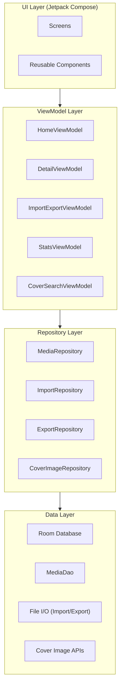
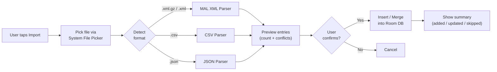

# 📋 LX Track List — Project Plan

> **A personal media tracking Android app for Anime, Manga, Manhwa, Movies, Shows & Books.**
> Built with Kotlin + Jetpack Compose · Local SQLite (Room) · Import / Export via files

---

## 1. Project Overview

| Field              | Detail                                                                         |
|--------------------|--------------------------------------------------------------------------------|
| **App Name**       | LX Track List                                                                  |
| **Package Name**   | `com.lx.tracklist`                                                             |
| **Platform**       | Android (min SDK 26 / Android 8.0)                                             |
| **Language**       | Kotlin                                                                         |
| **UI Framework**   | Jetpack Compose + Material 3                                                   |
| **Database**       | Room (SQLite) — fully local, user-controlled                                   |
| **Architecture**   | MVVM with Repository pattern                                                   |
| **Theme**          | Dark theme — **Primary Green `#A7EF60`** on **Black `#000000` / Dark surfaces** |
| **Logo**           | Cropped neon green circle with "**LX**" text on black bg (`plan/lx_logo.png`)  |
| **Current Users**  | Multi-user profiles with fast switcher by tapping the LX Logo                 |
| **Inspiration**    | [AnymeX](https://github.com/RyanYuuki/AnymeX) · [Anikku](https://github.com/komikku-app/anikku) · AnymeX UI layout (screenshot) |

---

## 2. Media Categories & Tracking Fields

### 2.1 Common Fields (All Media Types)

| Field              | Type         | Notes                                                      |
|--------------------|--------------|------------------------------------------------------------|
| `id`               | Long (PK)    | Auto-generated                                             |
| `title`            | String       | Required                                                   |
| `alternateTitle`   | String?      | e.g. Japanese / Korean title                               |
| `mediaType`        | Enum         | `ANIME`, `MANGA`, `MANHWA`, `MOVIE`, `SHOW`, `BOOK`       |
| `status`           | Enum         | `WATCHING`/`READING`, `COMPLETED`, `ON_HOLD`, `DROPPED`, `PLAN_TO_WATCH`/`PLAN_TO_READ` |
| `score`            | Int? (0-10)  | User's personal rating                                     |
| `startDate`        | LocalDate?   | When the user started                                      |
| `finishDate`       | LocalDate?   | When the user finished                                     |
| `notes`            | String?      | Free-form user comments                                    |
| `tags`             | String?      | Comma-separated tags                                       |
| `coverImageUri`    | String?      | Local file URI or web URL for cover art                    |
| `priority`         | Enum         | `LOW`, `MEDIUM`, `HIGH`                                    |
| `rewatchCount`     | Int          | Times re-watched / re-read                                 |
| `isFavorite`       | Boolean      | Quick-filter favorite entries                              |
| `externalId`       | String?      | ID from source (MAL ID, TMDB ID, etc.)                     |
| `externalSource`   | String?      | `MAL`, `ANILIST`, `TMDB`, `OMDB`, etc.                     |
| `createdAt`        | Long         | Timestamp of creation                                      |
| `updatedAt`        | Long         | Timestamp of last update                                   |

### 2.2 Anime-Specific Fields

| Field              | Type     | Notes                                       |
|--------------------|----------|---------------------------------------------|
| `totalEpisodes`    | Int?     | Total episodes (null if unknown / ongoing)   |
| `watchedEpisodes`  | Int      | User's current progress                      |
| `totalSeasons`     | Int?     | Number of seasons                            |
| `currentSeason`    | Int?     | Which season user is on                      |
| `seriesType`       | String?  | `TV`, `OVA`, `ONA`, `Movie`, `Special`       |
| `airingStatus`     | String?  | `AIRING`, `FINISHED`, `NOT_YET_AIRED`        |
| `airingDates`      | String?  | e.g. "2026-10-04 - ???"                      |

### 2.3 Show-Specific Fields (Live-Action TV)

| Field              | Type     | Notes                                       |
|--------------------|----------|---------------------------------------------|
| `totalEpisodes`    | Int?     | Total episodes                               |
| `watchedEpisodes`  | Int      | Progress                                     |
| `totalSeasons`     | Int?     | Total seasons                                |
| `currentSeason`    | Int?     | User's current season                        |
| `network`          | String?  | e.g. HBO, Netflix                            |

### 2.4 Movie-Specific Fields

| Field                  | Type     | Notes                                           |
|------------------------|----------|-------------------------------------------------|
| `isPartOfSeries`       | Boolean  | Is it a movie franchise (e.g. MCU, LOTR)?       |
| `seriesName`           | String?  | Name of the movie series                        |
| `movieNumber`          | Int?     | Which number in the franchise (1, 2, 3…)        |
| `totalMoviesInSeries`  | Int?     | Total movies in the franchise                   |
| `runtime`              | Int?     | Duration in minutes                             |

### 2.5 Manga-Specific Fields

| Field              | Type     | Notes                                       |
|--------------------|----------|---------------------------------------------|
| `totalVolumes`     | Int?     | Total volumes                                |
| `readVolumes`      | Int      | User's volume progress                       |
| `totalChapters`    | Int?     | Total chapters                               |
| `readChapters`     | Int      | User's chapter progress                      |
| `totalPages`       | Int?     | Total pages (for one-shots, etc.)            |
| `readPages`        | Int      | User's page progress                         |

> **Tracking flexibility**: The user can track by **volume**, **chapter**, **pages**, or **all together**. The progress bar and display adapt based on which fields are populated.

### 2.6 Manhwa-Specific Fields

Same as Manga (inherits all manga fields). Distinguished by `mediaType = MANHWA`.

### 2.7 Book-Specific Fields

| Field              | Type     | Notes                                       |
|--------------------|----------|---------------------------------------------|
| `author`           | String?  | Book author                                 |
| `isbn`             | String?  | ISBN number                                 |
| `totalPages`       | Int?     | Total page count                             |
| `readPages`        | Int      | User's page progress                         |
| `totalChapters`    | Int?     | Total chapters (if applicable)               |
| `readChapters`     | Int      | User's chapter progress                      |
| `totalVolumes`     | Int?     | For multi-volume book series                 |
| `readVolumes`      | Int      | User's volume progress                       |

---

## 3. App Architecture



### 3.1 Module / Package Structure

```
com.lx.tracklist/
├── data/
│   ├── db/
│   │   ├── AppDatabase.kt
│   │   ├── MediaDao.kt
│   │   ├── entity/
│   │   │   └── MediaEntry.kt          // Single Room entity with all fields
│   │   └── converter/
│   │       └── Converters.kt          // TypeConverters for enums, dates
│   ├── repository/
│   │   ├── MediaRepository.kt
│   │   ├── ImportRepository.kt
│   │   ├── ExportRepository.kt
│   │   └── CoverImageRepository.kt
│   ├── import/
│   │   ├── MalXmlParser.kt            // MyAnimeList XML (gzipped) parser
│   │   ├── CsvParser.kt               // Generic CSV import
│   │   ├── JsonParser.kt              // JSON import
│   │   └── ImportMapper.kt            // Maps external formats → MediaEntry
│   ├── export/
│   │   └── JsonExporter.kt            // Exports DB → JSON file
│   └── remote/
│       └── CoverImageService.kt       // Fetches cover images from web APIs
├── domain/
│   ├── model/
│   │   ├── MediaType.kt               // Enum
│   │   ├── WatchStatus.kt             // Enum
│   │   └── Priority.kt                // Enum
│   └── usecase/                        // (optional, for complex logic)
├── ui/
│   ├── theme/
│   │   ├── Color.kt                   // #A7EF60, #000000, etc.
│   │   ├── Theme.kt                   // LXTrackListTheme
│   │   └── Type.kt                    // Typography
│   ├── navigation/
│   │   └── NavGraph.kt
│   ├── screen/
│   │   ├── home/
│   │   │   ├── HomeScreen.kt
│   │   │   └── HomeViewModel.kt
│   │   ├── detail/
│   │   │   ├── DetailScreen.kt
│   │   │   └── DetailViewModel.kt
│   │   ├── add_edit/
│   │   │   ├── AddEditScreen.kt
│   │   │   └── AddEditViewModel.kt
│   │   ├── import_export/
│   │   │   ├── ImportExportScreen.kt
│   │   │   └── ImportExportViewModel.kt
│   │   ├── stats/
│   │   │   ├── StatsScreen.kt
│   │   │   └── StatsViewModel.kt
│   │   └── settings/
│   │       └── SettingsScreen.kt
│   └── component/
│       ├── MediaCard.kt               // Card with cover, title, progress
│       ├── ProgressBar.kt             // Green progress indicator
│       ├── StatusBadge.kt             // AIRING / COMPLETED badges
│       ├── FilterTabRow.kt            // WATCHING / PLAN TO WATCH / etc.
│       ├── CategoryTabRow.kt          // Anime / Manga / Shows / etc.
│       └── CoverImagePicker.kt        // Local pick + web search dialog
├── di/
│   └── AppModule.kt                   // Hilt / manual DI
└── LXTrackListApp.kt                  // Application class
```

---

## 4. UI Design — Inspired by AnymeX Layout

### 4.1 Theme / Color System

| Token               | Value                | Usage                                    |
|----------------------|----------------------|------------------------------------------|
| `Primary`            | `#A7EF60` (Green)    | Accent, active tabs, progress bars, FABs |
| `OnPrimary`          | `#000000` (Black)    | Text on primary surfaces                |
| `Background`         | `#000000` (Black)    | Main app background                     |
| `Surface`            | `#121212`            | Card backgrounds                        |
| `SurfaceVariant`     | `#1E1E1E`            | Elevated surfaces, bottom bar           |
| `OnSurface`          | `#FFFFFF`            | Primary text on dark                    |
| `OnSurfaceVariant`   | `#B0B0B0`            | Secondary / muted text                  |
| `ProgressTrack`      | `#333333`            | Inactive portion of progress bar        |
| `ProgressIndicator`  | `#A7EF60`            | Active portion of progress bar          |
| `Error`              | `#FF5252`            | Dropped status, errors                  |

### 4.2 Screen Layout (Matching AnymeX Screenshot)

#### Home Screen

```
┌─────────────────────────────────────────┐
│ ☰  Anime ▾                 🔄  🔍  ≡   │  ← Top App Bar (Hamburger / Category Dropdown,
├─────────────────────────────────────────┤     refresh, search, sort)
│ WATCHING (87)  PLAN TO WATCH (469)  ON… │  ← Status Filter Tabs (per category)
│ ════════                                │     (green underline for active tab)
├─────────────────────────────────────────┤
│ ┌──────┐                                │
│ │      │  Magical★Explorer         ⋮    │  ← Entry Card
│ │ Cover│  2026-10-04 - ???              │     - Thumbnail on left
│ │ Image│                                │     - Title + date range
│ │      │  1/13              [AIRING]    │     - Progress (current/total)
│ │      │  ■■░░░░░░░░░░░░░░░░░░░░░░     │     - Progress bar (#A7EF60)
│ └──────┘                                │     - Status badge (if applicable)
├─────────────────────────────────────────┤
│ ┌──────┐                                │
│ │      │  Gaikotsu Kishi-sama...   ⋮    │
│ │ Cover│  2026-07-06 - 2026-09-21      │
│ │      │                                │
│ │      │  5/12                          │
│ │      │  ■■■■■■■■░░░░░░░░░░░░░░░░     │
│ └──────┘                                │
├─────────────────────────────────────────┤
│   ...more entries...                    │
├─────────────────────────────────────────┤
│                              ╔═══╗      │
│                              ║ + ║      │  ← FAB: Add New Entry
│                              ╚═══╝      │
├─────────────────────────────────────────┤
│  🏠      📑       📊       ⚙️          │  ← Bottom Navigation
│  Home  Library   Stats   Settings       │
└─────────────────────────────────────────┘
```

#### Category Dropdown / Hamburger Menu

Tapping the category title or the hamburger icon `☰` opens the Category Selector:

```
┌───────────────────────────────┐
│ ☰  Categories                 │
├───────────────────────────────┤
│ ● 🎬 Anime               (87) │  ← Active category (#A7EF60 highlight)
│ ○ 📖 Manga              (142) │
│ ○ 📱 Manhwa              (34) │
│ ○ 🍿 Movies              (56) │
│ ○ 📺 Shows               (29) │
│ ○ 📚 Books               (18) │
└───────────────────────────────┘
```


#### Detail Screen

```
┌─────────────────────────────────────────┐
│  ←  Entry Detail                   ✏️   │
├─────────────────────────────────────────┤
│  ┌─────────────────────────────────┐    │
│  │                                 │    │
│  │        Cover Image (large)      │    │
│  │                                 │    │
│  └─────────────────────────────────┘    │
│                                         │
│  Title Name Here                        │
│  Alternate Title (Japanese/Korean)      │
│                                         │
│  ┌─────────┐ ┌─────────┐ ┌──────────┐  │
│  │ Status  │ │  Score  │ │ Priority │  │
│  │WATCHING │ │  ★ 8/10 │ │   HIGH   │  │
│  └─────────┘ └─────────┘ └──────────┘  │
│                                         │
│  Progress ──────────────────────────    │
│  Episodes:  5 / 12  [Season 1]         │
│  ■■■■■■■■░░░░░░░░░░░░░░░░  42%        │
│                                         │
│  ─── Details ───                        │
│  Type:        TV                        │
│  Start Date:  2026-07-06                │
│  End Date:    2026-09-21                │
│  Tags:        action, fantasy           │
│  Notes:       Great animation...        │
│                                         │
│  Source:      MAL (ID: 29809)           │
└─────────────────────────────────────────┘
```

#### Progress Display Logic

For **Anime / Shows**:
- **Season-based**: "Season 2 • Episode 5/12" with season selector
- **Episode-only**: "5/24" with progress bar

For **Movies**:
- **Standalone**: Just status (Watched / Plan to Watch)
- **Movie Series**: "3/8 movies" with progress bar

For **Manga / Manhwa / Books** (flexible — show whichever fields are populated):
- **Volume**: "Vol 5/20"
- **Chapter**: "Ch 45/200"
- **Pages**: "450/3200 pages"
- **Combined**: "Vol 5 • Ch 45 • 450p" (all shown if all populated)

### 4.3 Bottom Navigation

| Tab        | Icon | Screen                                          |
|------------|------|-------------------------------------------------|
| **Home**   | 🏠   | Main list with category dropdown/drawer + status filters |
| **Library**| 📑   | All entries in a grid/list view, searchable     |
| **Stats**  | 📊   | Charts: entries per status, per category, scores|
| **Settings**| ⚙️  | Import/Export, theme, about                     |

---

## 5. Import System

### 5.1 Supported Import Formats

| Source          | Format                       | File Extension        | Status       |
|-----------------|------------------------------|----------------------|--------------|
| MyAnimeList     | XML (gzipped)                | `.xml.gz` / `.xml`   | **Phase 1**  |
| Tachiyomi/Mihon | Protobuf (gzipped) / JSON    | `.tachibk` / `.proto.gz` | **Phase 1** |
| Generic CSV     | Comma-separated values       | `.csv`               | **Phase 1**  |
| Generic JSON    | JSON array of entries        | `.json`              | **Phase 1**  |
| AniList         | JSON                         | `.json`              | Phase 2      |
| Other trackers  | Various                      | Various              | Future       |

### 5.2 MAL XML Import Mapping

#### Anime (`user_export_type = 1`)

| MAL XML Field           | → App Field         |
|------------------------|---------------------|
| `series_animedb_id`    | `externalId`        |
| `series_title`         | `title`             |
| `series_type`          | `seriesType`        |
| `series_episodes`      | `totalEpisodes`     |
| `my_watched_episodes`  | `watchedEpisodes`   |
| `my_start_date`        | `startDate`         |
| `my_finish_date`       | `finishDate`        |
| `my_score`             | `score`             |
| `my_status`            | `status` (mapped)   |
| `my_comments`          | `notes`             |
| `my_tags`              | `tags`              |
| `my_times_watched`     | `rewatchCount`      |
| `my_priority`          | `priority` (mapped) |

**Status mapping**: `Watching` → `WATCHING`, `Completed` → `COMPLETED`, `On-Hold` → `ON_HOLD`, `Dropped` → `DROPPED`, `Plan to Watch` → `PLAN_TO_WATCH`

#### Manga (`user_export_type = 2`)

| MAL XML Field           | → App Field         |
|------------------------|---------------------|
| `manga_mangadb_id`     | `externalId`        |
| `manga_title`          | `title`             |
| `manga_volumes`        | `totalVolumes`      |
| `manga_chapters`       | `totalChapters`     |
| `my_read_volumes`      | `readVolumes`       |
| `my_read_chapters`     | `readChapters`      |
| `my_start_date`        | `startDate`         |
| `my_finish_date`       | `finishDate`        |
| `my_score`             | `score`             |
| `my_status`            | `status` (mapped)   |
| `my_comments`          | `notes`             |
| `my_tags`              | `tags`              |
| `my_times_read`        | `rewatchCount`      |
| `my_priority`          | `priority` (mapped) |

**Status mapping**: `Reading` → `READING`, `Completed` → `COMPLETED`, `On-Hold` → `ON_HOLD`, `Dropped` → `DROPPED`, `Plan to Read` → `PLAN_TO_READ`

### 5.3 CSV Import Format

Expected CSV columns (flexible — unmapped columns are ignored):

```csv
title,mediaType,status,score,startDate,finishDate,totalEpisodes,watchedEpisodes,totalChapters,readChapters,totalVolumes,readVolumes,totalPages,readPages,notes,tags
```

### 5.4 JSON Import Format

```json
[
  {
    "title": "Attack on Titan",
    "mediaType": "ANIME",
    "status": "COMPLETED",
    "score": 9,
    "totalEpisodes": 87,
    "watchedEpisodes": 87,
    "startDate": "2020-01-15",
    "finishDate": "2023-11-05"
  }
]
```

### 5.5 Import Flow (UX)



---

## 6. Export System

### 6.1 Export Format

Export is **JSON** only (for now). The output file contains the full database:

```json
{
  "exportDate": "2026-10-27T16:30:00+05:30",
  "appVersion": "1.0.0",
  "totalEntries": 274,
  "entries": [
    {
      "title": "Magical Explorer",
      "mediaType": "ANIME",
      "status": "WATCHING",
      "score": null,
      "totalEpisodes": 13,
      "watchedEpisodes": 1,
      "currentSeason": 1,
      "totalSeasons": 1,
      "startDate": "2026-10-04",
      "finishDate": null,
      "notes": "",
      "tags": "",
      "coverImageUri": null,
      "externalId": "54321",
      "externalSource": "MAL",
      "createdAt": 1698412200000,
      "updatedAt": 1698412200000
    }
  ]
}
```

### 6.2 Export Options

- **Export All**: Every entry across all categories
- **Export by Category**: Only Anime, only Manga, etc.
- **Export by Status**: Only Completed, only Watching, etc.
- File is saved via Android's **Storage Access Framework** (user picks destination)

---

## 7. Cover Image System

### 7.1 Image Sources

| Source        | API / Method                    | Media Types Covered        | Auth Required?  |
|---------------|---------------------------------|----------------------------|-----------------|
| **Local Pick**| Android image picker            | All                        | No              |
| **Fanart.tv** | `https://webservice.fanart.tv`  | Anime, Movies, Shows       | Free API key    |
| **TMDB**      | `https://api.themoviedb.org/3`  | Movies, Shows, Anime       | Free API key    |
| **OMDB**      | `https://www.omdbapi.com`       | Movies, Shows              | Free API key    |
| **MangaDex**  | `https://api.mangadex.org`      | Manga, Manhwa              | No              |
| **AniDB**     | Via image URLs                  | Anime                      | No              |
| **Jikan**     | `https://api.jikan.moe/v4`     | Anime, Manga (MAL data)    | No              |

### 7.2 Cover Image Flow

1. User opens **Cover Image Picker** dialog
2. Options shown:
   - **Pick from device** → Android photo picker
   - **Search online** → Text search across relevant APIs based on media type
3. Search shows a grid of results
4. User taps an image → downloaded and cached locally in app's internal storage
5. File URI is stored in `coverImageUri` field

### 7.3 Image Storage

- Images are stored in `app_internal/covers/` directory
- Filename: `{mediaType}_{entryId}.webp` (compressed)
- Images are included in backup/export as a separate zip (future enhancement)

---

## 8. Database Schema (Room)

### 8.1 Single Entity Strategy

Use a **single `MediaEntry` entity** with nullable fields for type-specific data. This simplifies queries, import/export, and avoids complex joins.

```kotlin
@Entity(
    tableName = "media_entries",
    indices = [
        Index(value = ["mediaType", "status"]),
        Index(value = ["title"]),
        Index(value = ["externalId", "externalSource"], unique = true)
    ]
)
data class MediaEntry(
    @PrimaryKey(autoGenerate = true)
    val id: Long = 0,

    // ── Common ──
    val title: String,
    val alternateTitle: String? = null,
    val mediaType: MediaType,
    val status: WatchStatus,
    val score: Int? = null,
    val startDate: String? = null,           // ISO 8601 date string
    val finishDate: String? = null,
    val notes: String? = null,
    val tags: String? = null,
    val coverImageUri: String? = null,
    val priority: Priority = Priority.LOW,
    val rewatchCount: Int = 0,
    val isFavorite: Boolean = false,
    val externalId: String? = null,
    val externalSource: String? = null,
    val createdAt: Long = System.currentTimeMillis(),
    val updatedAt: Long = System.currentTimeMillis(),

    // ── Watch types (Anime, Show) ──
    val totalEpisodes: Int? = null,
    val watchedEpisodes: Int = 0,
    val totalSeasons: Int? = null,
    val currentSeason: Int? = null,
    val seriesType: String? = null,
    val airingStatus: String? = null,
    val airingDates: String? = null,
    val network: String? = null,

    // ── Movie ──
    val isPartOfSeries: Boolean = false,
    val seriesName: String? = null,
    val movieNumber: Int? = null,
    val totalMoviesInSeries: Int? = null,
    val runtime: Int? = null,

    // ── Read types (Manga, Manhwa, Book) ──
    val totalVolumes: Int? = null,
    val readVolumes: Int = 0,
    val totalChapters: Int? = null,
    val readChapters: Int = 0,
    val totalPages: Int? = null,
    val readPages: Int = 0,
    val author: String? = null,
    val isbn: String? = null
)
```

### 8.2 Key DAO Queries

```kotlin
@Dao
interface MediaDao {
    // ── Reads ──
    @Query("SELECT * FROM media_entries WHERE mediaType = :type ORDER BY updatedAt DESC")
    fun getByType(type: MediaType): Flow<List<MediaEntry>>

    @Query("SELECT * FROM media_entries WHERE mediaType = :type AND status = :status ORDER BY title ASC")
    fun getByTypeAndStatus(type: MediaType, status: WatchStatus): Flow<List<MediaEntry>>

    @Query("SELECT * FROM media_entries WHERE id = :id")
    fun getById(id: Long): Flow<MediaEntry?>

    @Query("SELECT * FROM media_entries WHERE title LIKE '%' || :query || '%' OR alternateTitle LIKE '%' || :query || '%'")
    fun search(query: String): Flow<List<MediaEntry>>

    @Query("SELECT mediaType, status, COUNT(*) as count FROM media_entries GROUP BY mediaType, status")
    fun getStats(): Flow<List<StatRow>>

    @Query("SELECT * FROM media_entries WHERE isFavorite = 1 ORDER BY title ASC")
    fun getFavorites(): Flow<List<MediaEntry>>

    // ── Writes ──
    @Insert(onConflict = OnConflictStrategy.REPLACE)
    suspend fun upsert(entry: MediaEntry): Long

    @Insert(onConflict = OnConflictStrategy.REPLACE)
    suspend fun upsertAll(entries: List<MediaEntry>)

    @Delete
    suspend fun delete(entry: MediaEntry)

    @Query("DELETE FROM media_entries")
    suspend fun deleteAll()

    // ── Export ──
    @Query("SELECT * FROM media_entries ORDER BY mediaType, title")
    suspend fun getAll(): List<MediaEntry>
}
```

---

## 9. Dependencies

| Library                          | Purpose                                | Version (approx.)  |
|----------------------------------|----------------------------------------|---------------------|
| `androidx.compose.material3`     | Material 3 UI components               | Latest stable       |
| `androidx.compose.navigation`    | Jetpack Compose Navigation             | Latest stable       |
| `androidx.room`                  | SQLite ORM                             | 2.6+                |
| `androidx.lifecycle`             | ViewModels + lifecycle-aware flows     | 2.8+                |
| `io.coil-kt:coil-compose`       | Image loading (local + remote covers)  | 2.x                 |
| `com.google.code.gson`           | JSON serialization/deserialization      | 2.10+               |
| `org.apache.commons:commons-csv` | CSV parsing (or manual implementation) | 1.10+               |
| `com.google.dagger:hilt-android` | Dependency injection                   | 2.50+               |
| `com.squareup.retrofit2`        | HTTP client for cover image APIs       | 2.9+                |
| `com.squareup.okhttp3`          | HTTP interceptors, logging             | 4.12+               |
| `org.jetbrains.kotlinx:kotlinx-coroutines` | Async operations            | 1.8+                |

---

## 10. Development Phases

### Phase 1 — Core MVP 🏗️

> **Goal**: Functional tracker with import/export and basic UI

| #   | Task                                      | Priority  | Est. Effort |
|-----|-------------------------------------------|-----------|-------------|
| 1.1 | Project setup (Compose, Room, Hilt, Nav)  | Critical  | 1 day       |
| 1.2 | Define theme (colors, typography, shapes) | Critical  | 0.5 day     |
| 1.3 | Room entity + DAO + Database              | Critical  | 1 day       |
| 1.4 | Repository layer                          | Critical  | 0.5 day     |
| 1.5 | Home screen — category dropdown/drawer + status tabs | Critical  | 2 days      |
| 1.6 | Media card component (AnymeX style)       | Critical  | 1 day       |
| 1.7 | Add/Edit entry screen                     | Critical  | 2 days      |
| 1.8 | Detail screen                             | High      | 1 day       |
| 1.9 | MAL XML import (anime + manga)            | Critical  | 2 days      |
| 1.10| CSV import                                | High      | 1 day       |
| 1.11| JSON import                               | High      | 1 day       |
| 1.12| JSON export                               | High      | 1 day       |
| 1.13| Bottom navigation                         | Critical  | 0.5 day     |
| 1.14| Search functionality                      | High      | 0.5 day     |
| 1.15| Sort & filter options                     | High      | 1 day       |

**Phase 1 Total**: ~15 days

### Phase 2 — Polish & Cover Images 🎨

| #   | Task                                      | Priority  | Est. Effort |
|-----|-------------------------------------------|-----------|-------------|
| 2.1 | Cover image picker (local)                | High      | 1 day       |
| 2.2 | Cover image search (Jikan / TMDB / MangaDex) | High  | 2 days      |
| 2.3 | Stats screen with charts                  | Medium    | 2 days      |
| 2.4 | Settings screen                           | Medium    | 1 day       |
| 2.5 | Quick-increment progress (tap +1 episode) | High      | 0.5 day     |
| 2.6 | Swipe actions on cards (mark complete, etc.)| Medium  | 1 day       |
| 2.7 | Favorites system                          | Medium    | 0.5 day     |
| 2.8 | Splash screen + logo integration          | Low       | 0.5 day     |
| 2.9 | Polish animations & transitions           | Medium    | 1 day       |

**Phase 2 Total**: ~9.5 days

### Phase 3 — Extended Features 🚀

| #   | Task                                      | Priority  | Est. Effort |
|-----|-------------------------------------------|-----------|-------------|
| 3.1 | AniList JSON import                       | Medium    | 1 day       |
| 3.2 | Library screen (grid view + search)       | Medium    | 1.5 days    |
| 3.3 | Backup & restore (full DB export/import)  | Medium    | 1 day       |
| 3.4 | Notification reminders (new episodes)     | Low       | 2 days      |
| 3.5 | Multi-user support                        | Low       | 3 days      |
| 3.6 | Widget for currently watching/reading     | Low       | 2 days      |
| 3.7 | Additional cover image sources            | Low       | 1 day       |

**Phase 3 Total**: ~11.5 days

---

## 11. Import/Export File Handling Details

### 11.1 File Picker Integration

Use Android's **Storage Access Framework** with `ActivityResultContracts`:

```kotlin
// Import
val importLauncher = rememberLauncherForActivityResult(
    contract = ActivityResultContracts.OpenDocument()
) { uri ->
    // Read file from URI
}

// Export
val exportLauncher = rememberLauncherForActivityResult(
    contract = ActivityResultContracts.CreateDocument("application/json")
) { uri ->
    // Write JSON to URI
}
```

### 11.2 MIME Types for Import

| Format            | MIME Type                                              |
|-------------------|--------------------------------------------------------|
| Tachiyomi/Mihon   | `application/gzip`, `application/octet-stream`, `*/*`  |
| XML (gzip)        | `application/gzip`, `application/x-gzip`              |
| XML               | `text/xml`, `application/xml`                          |
| CSV               | `text/csv`, `text/comma-separated-values`              |
| JSON              | `application/json`                                     |

### 11.3 Conflict Resolution on Import

When an entry with the same `externalId` + `externalSource` already exists:

| Strategy       | Behavior                                                   |
|----------------|-------------------------------------------------------------|
| **Skip**       | Keep existing entry, ignore imported one                    |
| **Overwrite**  | Replace existing with imported data                         |
| **Merge**      | Keep higher progress, newer dates, merge tags               |

User selects strategy before confirming import.

---

## 12. Future Considerations

- 🌐 **Online sync** with AniList / MAL APIs (read-write)
- 🎨 **Custom themes** beyond green + black
- 📱 **Tablet / landscape layouts**
- 🔔 **Airing schedule** integration
- 📤 **Export to CSV** format
- 🗄️ **Migration to multi-table schema** if performance requires it
- 🔐 **App lock** (PIN / biometric)
- 📊 **Advanced stats**: reading pace, watching trends over time

---

## 13. Reference Materials

| Resource                     | Location                                                                       |
|------------------------------|--------------------------------------------------------------------------------|
| AnymeX UI Screenshot         | [screen shot.jpeg](file:///g:/LX/Git%20Repos/LX%20Track%20List/plan/screen%20shot.jpeg) |
| Inspiration Repos            | [inspiration_repos.txt](file:///g:/LX/Git%20Repos/LX%20Track%20List/plan/inspiration_repos.txt) |
| MAL Anime Export Sample      | [data/input](file:///g:/LX/Git%20Repos/LX%20Track%20List/data/input) |
| MAL Manga Export Sample      | [data/input](file:///g:/LX/Git%20Repos/LX%20Track%20List/data/input) |

---

> **Next Step**: Once this plan is approved, we'll begin Phase 1 by initializing the Android project and building the core data layer + theme.
