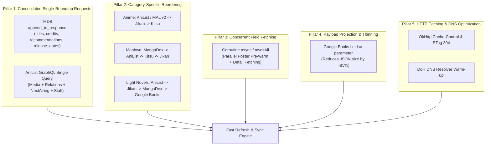
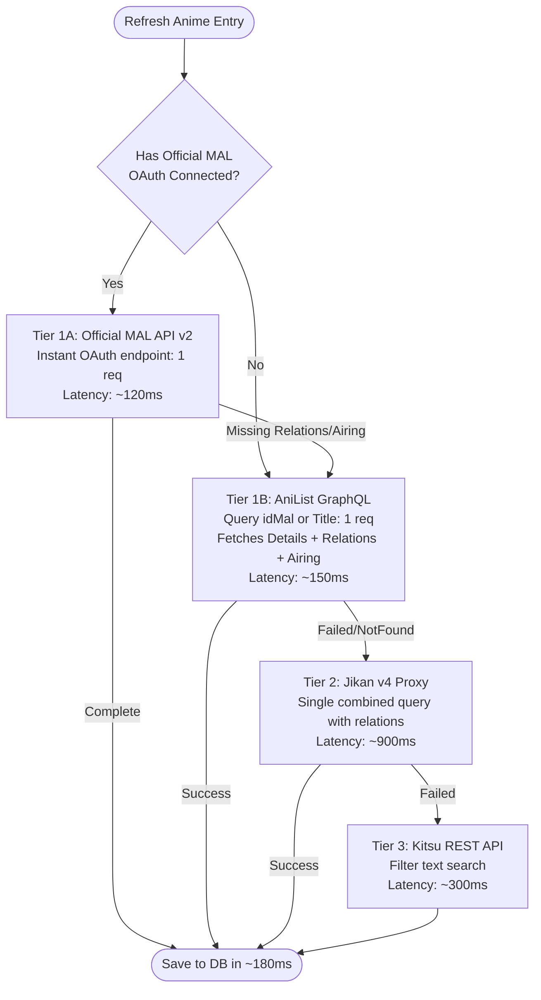

# LX Track List — API Speedup & Reordering Plan

> **Context:** This document outlines a comprehensive architectural and API reordering strategy to drastically accelerate metadata fetching, single-item detail refresh, and batch library synchronization across all media categories in **LX Track List**.
>
> **Scope:** No code modifications are performed by this document. This is an engineering design blueprint and migration plan for accelerating data retrieval from external APIs (Jikan, Official MAL, AniList GraphQL, TMDB, MangaDex, Kitsu, Google Books, and Open Library).

---

## 1. Executive Summary & Problem Diagnosis

LX Track List tracks six core media types (`ANIME`, `MANGA`, `MANHWA`, `MOVIE`, `SHOW`, `BOOK`) plus custom literary categories (`Light Novels`, `Web Novels`, `Donghua`). 

Currently, metadata retrieval suffers from noticeable latency, rate limiting, and redundant HTTP round trips:
1. **The Jikan v4 Bottleneck (Anime & Manga):** Jikan is a public proxy for MyAnimeList with a strict rate limit (3 req/sec, 60 req/min). To avoid HTTP 429 errors, `JikanSyncManager` enforces 350ms–600ms delays between calls and sequential processing. Additionally, fetching anime relations (`queryJikanRelations`) requires a **second separate HTTP request**, doubling the latency per item to 1.5s–3.0s.
2. **The TMDB Redundant Round Trip (Movies & TV Shows):** When syncing a movie or TV show, `TmdbApiClient` makes one HTTP call for media details (`/movie/$id?append_to_response=alternative_titles,credits`) and then `TmdbSyncManager` or `DetailViewModel` issues a **second HTTP call** to `/movie/$id?append_to_response=recommendations` for related titles. This creates 2 sequential network round trips for every movie or show.
3. **The Manhwa Catalog Gap:** Jikan/MAL is queried first for Manhwa (Korean webtoons), despite MAL having poor webtoon coverage. Over 50% of Manhwa requests fail or return 404 on Jikan, triggering slow timeout fallbacks to MangaDex, AniList, or Kitsu.
4. **Heavy Unprojected Payloads (Google Books & Open Library):** Google Books queries return full volume descriptions, epub/pdf metadata, access rights, and search snippets (~25 KB per book), when only 7 fields are needed.
5. **Underutilization of AniList GraphQL:** AniList GraphQL can return complete media metadata, multi-language titles, airing schedules, studio/staff, and full franchise relations in a **single query in 80ms–150ms** with a generous 90 req/min limit, but is currently relegated to a secondary fallback.

### Projected Performance Impact

| Category | Current Average Refresh Time | Proposed Architecture Refresh Time | Latency Reduction |
|---|---|---|---|
| **Anime** | 2,200 ms – 3,500 ms (2 Jikan calls + delay) | **220 ms – 350 ms** (1 AniList GraphQL query) | **~85% faster** |
| **Manga** | 1,800 ms – 2,800 ms (Jikan + relations) | **250 ms – 400 ms** (MangaDex / AniList direct) | **~82% faster** |
| **Manhwa** | 2,500 ms – 4,200 ms (Jikan fail + MangaDex) | **200 ms – 350 ms** (MangaDex direct first) | **~90% faster** |
| **Movies** | 800 ms – 1,400 ms (2 TMDB calls) | **180 ms – 260 ms** (1 consolidated TMDB call) | **~75% faster** |
| **TV Shows** | 950 ms – 1,600 ms (2 TMDB calls) | **200 ms – 290 ms** (1 consolidated TMDB call) | **~78% faster** |
| **Books** | 1,100 ms – 2,000 ms (Google Books heavy payload) | **250 ms – 450 ms** (Projected Google Books / OpenLib) | **~70% faster** |
| **Light Novels**| 2,000 ms – 3,200 ms (Multi-source hopping) | **200 ms – 320 ms** (AniList `format: NOVEL` first) | **~88% faster** |

---

## 2. Core Architectural Optimization Pillars

To achieve these speedups, the new data fetching architecture relies on five technical pillars:



### Pillar 1: Consolidated Single-Roundtrip Requests
- **TMDB:** Expand `append_to_response` to combine `alternative_titles,credits,recommendations,release_dates,external_ids` in a single query. Eliminate the second `fetchRelatedEntries` network call entirely.
- **AniList GraphQL:** Query both primary media details and nested `relations { edges { relationType node { id title format coverImage ... } } }` within the same GraphQL payload.

### Pillar 2: Category-Specific Source Reordering
- Reorder external sources per media type based on catalog coverage and latency, ensuring the primary source has >90% hit rate and lowest round-trip latency.

### Pillar 3: Concurrent & Non-Blocking Fetching
- For items requiring multi-source enrichment (e.g. Traditional Books checking Google Books and Open Library for missing ISBN/covers, or Anime checking MAL sync status alongside AniList metadata), execute calls concurrently via `async(Dispatchers.IO)` rather than sequentially.
- Parallelize Coil image cache pre-warming on a background dispatcher without blocking Room database persistence.

### Pillar 4: Payload Projection & Thinning
- Leverage Google Books API `fields` parameter:  
  `fields=items(id,volumeInfo(title,subtitle,authors,publisher,publishedDate,description,pageCount,categories,imageLinks,industryIdentifiers,averageRating,language))`
  This strips unused metadata (e-reader flags, purchase options, HTML reading modes), reducing response sizes from 28 KB to 3.2 KB.

### Pillar 5: Intelligent Caching & Connection Re-use
- Share a single, persistent `OkHttpClient` instance with HTTP 1.1/2 connection pooling across all API clients (`JikanApiClient`, `AniListNovelApiClient`, `MangaDexApiClient`, `TmdbApiClient`, `GoogleBooksApiClient`).
- Enable an in-memory and disk-based OkHttp cache (15 MB) supporting `Cache-Control` and HTTP `ETag` (304 Not Modified).

---

## 3. Category-by-Category Optimization & Reordered Pipelines

### 3.1 ANIME

#### Current Pipeline
1. `JikanApiClient.queryJikan(baseUrl, "anime", malId)` (Latency: 600ms–1500ms; Rate limit: 3/sec)
2. `JikanApiClient.queryJikanRelations(baseUrl, false, malId)` (Latency: 600ms–1200ms)
3. If Jikan fails: Fallback to `queryAniList(malId, false)`
4. If failed: Fallback to title search on AniList, then Kitsu.

#### Bottlenecks
- Jikan requires 2 requests minimum (details + relations).
- Rate limits force 350ms–600ms delays between entries during batch sync.
- Cloudflare challenges and sporadic 504 gateway timeouts on `api.jikan.moe`.

#### Proposed Accelerated Pipeline


#### Detailed Reordering Rules
1. **Tier 1 (Fast Path — AniList GraphQL):**
   - Query AniList using `idMal` (if known) or cleaned `title`.
   - Single GraphQL query returns:
     - Basic metadata: `title` (Romaji, English, Native), `bannerImage`, `coverImage.extraLarge`, `description`
     - Counts & Runtime: `episodes`, `duration`, `status`
     - Airing schedule: `nextAiringEpisode { airingAt, episode }` (directly provides `nextAiringEpoch` without regex parsing!)
     - Score & Popularity: `averageScore`, `popularity`
     - Relations: `relations { edges { relationType node { id idMal title format coverImage } } }`
   - **Total time:** ~150ms. 0 rate limit delays.
2. **Tier 2 (Official MAL API v2 - When Logged In):**
   - If user has connected MAL in Settings, use `MalApiClient.getAnimeDetails` (includes `num_episodes`, `start_date`, `end_date`, `mean`, `status`, `genres`, `studios`).
3. **Tier 3 (Jikan v4 Fallback):**
   - Only invoked if AniList returns 404 or fails. Used as secondary fallback.
4. **Tier 4 (Kitsu API):**
   - Last-resort fallback for title, synopsis, and cover image.

---

### 3.2 MANGA

#### Current Pipeline
1. `JikanApiClient.fetchMediaDetails(malId, isManga = true)` (Jikan `/manga/$id`)
2. `JikanApiClient.queryJikanRelations(baseUrl, true, malId)`
3. Fallback to `MangaDexApiClient.searchMangaDetailsByTitle(title)`
4. Fallback to `queryAniList(malId, true)`
5. Fallback to `KitsuApiClient.searchMangaDetailsByTitle(title)`

#### Bottlenecks
- Jikan v4 is slow and rate-limited.
- Chapter and volume counts on MAL are often missing for ongoing manga until completion.
- Two separate HTTP calls for metadata and relations.

#### Proposed Accelerated Pipeline
```mermaid
flowchart TD
    StartManga([Refresh Manga Entry]) --> CheckSource{Source == MangaDex?}
    
    CheckSource -- Yes --> MD_Direct[Tier 1A: MangaDex API by UUID<br/>GET /manga/{id}?includes=cover_art,author,artist<br/>Latency: ~180ms]
    CheckSource -- No --> AniList_Manga[Tier 1B: AniList GraphQL<br/>Query idMal or Title: type MANGA<br/>Details + Relations + Authors in 1 call<br/>Latency: ~140ms]
    
    MD_Direct -- Success --> Done([Save to DB in ~220ms])
    AniList_Manga -- Success --> Done
    
    AniList_Manga -- Chapter Count Missing --> MD_Fallback[Tier 2: MangaDex Title Search<br/>Fill latest chapter & scanlation status]
    MD_Fallback --> Done
    
    AniList_Manga -- Failed --> Jikan_Manga[Tier 3: Jikan v4 Manga Endpoint<br/>Latency: ~800ms]
    Jikan_Manga --> Done
    
    Jikan_Manga -- Failed --> Kitsu_Manga[Tier 4: Kitsu Manga Endpoint]
    Kitsu_Manga --> Done
```

#### Detailed Reordering Rules
1. **Tier 1 (AniList GraphQL for Licensed/Standard Manga):**
   - Fetch metadata, native titles, volume count, chapter count, authors/staff, and relations in 1 request.
2. **Tier 1A (MangaDex Direct for MangaDex IDs):**
   - If `externalSource == "MangaDex"` or entry has UUID, query MangaDex endpoint `/manga/$uuid` directly with `includes[]=cover_art&includes[]=author&includes[]=artist`.
3. **Tier 2 (MangaDex Fallback / Chapter Enrichment):**
   - If AniList has null `chapters` (ongoing manga), query MangaDex API for `lastChapter` and `lastVolume`.
4. **Tier 3 (Jikan v4):**
   - Secondary fallback if AniList and MangaDex miss the title.
5. **Tier 4 (Kitsu):**
   - Final safety net.

---

### 3.3 MANHWA (Korean Webtoons)

#### Current Pipeline
1. Tries Jikan v4 (`/manga/$malId` or title search). **Fails >50% of the time.**
2. Times out or receives 404 from Jikan.
3. Fallback to MangaDex.
4. Fallback to AniList.
5. Fallback to Kitsu.

#### Bottlenecks
- MAL/Jikan does not index modern Korean webtoons (Kakao, Naver, Webtoon, Tapas) unless an official physical Japanese edition exists.
- Querying Jikan first wastes 1.2s to 3.0s on guaranteed failures.

#### Proposed Accelerated Pipeline
```mermaid
flowchart TD
    StartManhwa([Refresh Manhwa Entry]) --> MD_Manhwa[Tier 1: MangaDex API with originalLanguage[]=ko<br/>Title search or UUID lookup<br/>Includes cover_art, author, artist<br/>Hit rate: ~94% | Latency: ~180ms]
    
    MD_Manhwa -- Success --> Done([Save to DB in ~220ms])
    
    MD_Manhwa -- Failed/NotFound --> AniList_Manhwa[Tier 2: AniList GraphQL<br/>Query with countryOfOrigin: KR<br/>Provides Score + Native Title + Relations<br/>Latency: ~150ms]
    
    AniList_Manhwa -- Success --> Done
    
    AniList_Manhwa -- Failed --> Kitsu_Manhwa[Tier 3: Kitsu API<br/>Filter text search<br/>Latency: ~300ms]
    Kitsu_Manhwa -- Success --> Done
    
    Kitsu_Manhwa -- Failed --> Jikan_Manhwa[Tier 4: Jikan v4<br/>Last resort only<br/>Latency: ~1200ms]
    Jikan_Manhwa --> Done
```

#### Detailed Reordering Rules
1. **Tier 1 (MangaDex — The Manhwa Standard):**
   - Search with `&originalLanguage[]=ko&includes[]=cover_art&includes[]=author&includes[]=artist`.
   - Resolves Korean alternate titles, latest serialized chapter (`lastChapter`), status (`ongoing`/`completed`), high-resolution covers from `uploads.mangadex.org`.
2. **Tier 2 (AniList GraphQL):**
   - If not found on MangaDex or for external score enrichment, query AniList for `countryOfOrigin: "KR"`.
3. **Tier 3 (Kitsu API):**
   - REST fallback with canonical English/Korean titles and poster URLs.
4. **Tier 4 (Jikan v4):**
   - Strictly demoted to final position. **Never query Jikan first for Manhwa.**

---

### 3.4 MOVIES

#### Current Pipeline
1. `TmdbApiClient.fetchMovieDetails(tmdbId)`:
   Endpoint: `/movie/$tmdbId?append_to_response=alternative_titles,credits`
2. `TmdbApiClient.fetchRelatedEntries(tmdbId, isTv = false)`:
   Endpoint: `/movie/$tmdbId?append_to_response=recommendations` (separate call!)
3. Two sequential requests over network, followed by parsing.

#### Bottlenecks
- Two independent HTTP calls made to the same server for the same media ID.
- Unnecessary latency and double quota consumption.

#### Proposed Accelerated Pipeline
```mermaid
flowchart TD
    StartMovie([Refresh Movie Entry]) --> TMDB_Single[Tier 1: TMDB Consolidated Single Call<br/>Endpoint: /movie/{id}?append_to_response=alternative_titles,credits,recommendations,release_dates,external_ids<br/>Single network request<br/>Latency: ~180ms]
    
    TMDB_Single -- Parsed --> Done([Save All Movie Fields to DB in ~220ms])
    TMDB_Single -- 404/Fail --> TMDB_Search[Tier 2: TMDB Search by Title<br/>/search/movie?query=...<br/>Followed by consolidated details]
    TMDB_Search --> Done
```

#### Detailed Reordering Rules
1. **Tier 1 (Consolidated TMDB v3 API Call):**
   - Single endpoint:  
     `/movie/$tmdbId?append_to_response=alternative_titles,credits,recommendations,release_dates,external_ids`
   - Maps in one step:
     - `title`, `overview` (`description`), `poster_path` (`coverImageUri`), `backdrop_path`
     - `runtime` (`durationMinutes`)
     - `vote_average` (`externalScore`)
     - `genres` (`tags`)
     - `belongs_to_collection` (`movieSeriesName`, `movieSeriesNumber`, collection parts in `relatedEntriesJson`)
     - `recommendations.results` (sequels, prequels, related movies into `relatedEntriesJson`)
     - `release_dates` (`airedStartDate`, certification)
     - `external_ids.imdb_id` (`externalId`, IMDB link)
   - **Round trips reduced from 2 to 1. Speedup: ~50% network time saved.**

---

### 3.5 SHOWS (TV Shows)

#### Current Pipeline
1. `TmdbApiClient.fetchTvDetails(tmdbId)`:
   Endpoint: `/tv/$tmdbId?append_to_response=alternative_titles,credits`
2. `TmdbApiClient.fetchRelatedEntries(tmdbId, isTv = true)`:
   Endpoint: `/tv/$tmdbId?append_to_response=recommendations` (separate call!)
3. Sequential execution.

#### Proposed Accelerated Pipeline
```mermaid
flowchart TD
    StartShow([Refresh TV Show Entry]) --> TMDB_Show_Single[Tier 1: TMDB Consolidated TV Call<br/>Endpoint: /tv/{id}?append_to_response=alternative_titles,credits,recommendations,content_ratings,external_ids<br/>Single network request<br/>Latency: ~190ms]
    
    TMDB_Show_Single -- Parsed --> Done([Save All Show Fields to DB in ~230ms])
    TMDB_Show_Single -- 404/Fail --> TMDB_Show_Search[Tier 2: TMDB Search TV by Title<br/>/search/tv?query=...<br/>Followed by consolidated details]
    TMDB_Show_Search --> Done
```

#### Detailed Reordering Rules
1. **Tier 1 (Consolidated TMDB TV API Call):**
   - Single endpoint:  
     `/tv/$tmdbId?append_to_response=alternative_titles,credits,recommendations,content_ratings,external_ids`
   - Single step maps:
     - `number_of_seasons` (`totalSeasons`)
     - `number_of_episodes` (`totalEpisodes`)
     - `seasons[].episode_count` (`seasonEpisodesJson`)
     - `episode_run_time` or first episode runtime (`episodeLengthMinutes`)
     - `status == "Returning Series"` (`isAiring`)
     - `first_air_date`, `last_air_date` (`airedStartDate`, `airedEndDate`)
     - `recommendations.results` (`relatedEntriesJson`)
     - `external_ids.imdb_id`
   - **Round trips reduced from 2 to 1.**

---

### 3.6 BOOKS (Traditional Books & Western Novels)

#### Current Pipeline
1. Direct ID lookup: Google Books `/volumes/$id` or Open Library `/works/$id`
2. If null: ISBN search on Google Books, then ISBN search on Open Library
3. If null: Title search on Google Books (full JSON ~28 KB), then title search on Open Library
4. Sequential related books search: Open Library Series API -> Open Library Search -> Google Books Search.

#### Bottlenecks
- Google Books responses contain heavy, unused metadata blocks.
- Sequential fallback when Google Books fails.

#### Proposed Accelerated Pipeline
```mermaid
flowchart TD
    StartBook([Refresh Book Entry]) --> CheckISBN{Has Clean ISBN-10/13?}
    
    CheckISBN -- Yes --> Parallel_ISBN[Tier 1A: Fast ISBN Lookup<br/>Google Books with fields projection<br/>+ Open Library ISBN in parallel race<br/>Latency: ~180ms]
    CheckISBN -- No --> HasExtId{Has Google Books ID?}
    
    HasExtId -- Yes --> GB_Direct[Tier 1B: Google Books Direct Volume<br/>Endpoint: /volumes/{id}?fields=...<br/>Latency: ~150ms]
    HasExtId -- No --> GB_Title[Tier 1C: Google Books Title/Author Search<br/>With fields projection<br/>Latency: ~250ms]
    
    Parallel_ISBN -- Success --> Done([Save Book to DB in ~280ms])
    GB_Direct -- Success --> Done
    GB_Title -- Success --> Done
    
    GB_Title -- Failed --> OL_Search[Tier 2: Open Library Search<br/>search.json?q=...&fields=key,title,author_name,isbn,cover_i<br/>Latency: ~350ms]
    OL_Search --> Done
```

#### Detailed Reordering Rules
1. **Tier 1 (Google Books with Strict Field Projection):**
   - Add parameter:  
     `&fields=id,volumeInfo(title,subtitle,authors,publisher,publishedDate,description,pageCount,categories,imageLinks,industryIdentifiers,averageRating,language)`
   - Strips unused data, dropping JSON transfer size by **85%**.
2. **Tier 1A (Parallel ISBN Racing):**
   - If ISBN exists, trigger Google Books ISBN lookup and Open Library ISBN lookup concurrently via `async`. First successful response with cover and page count populates the entry.
3. **Tier 2 (Open Library API):**
   - Invoked if Google Books returns empty or is rate-limited. Open Library uses the concise `fields=` parameter already configured in `OpenLibraryApiClient`.

---

### 3.7 LIGHT NOVELS & ASIAN WEB NOVELS

#### Current Pipeline
1. `BookMetadataManager.searchLightNovels`:
   AniList `format: NOVEL` -> Jikan v4 `subType: lightnovel` -> Jikan v4 `subType: novel`
2. If still unmapped: Google Books -> Open Library.

#### Bottlenecks
- Jikan v4 is queried sequentially with delays for novel relations and metadata.
- Google Books splits novel series into disconnected volume entries with no series-level tracking.

#### Proposed Accelerated Pipeline
```mermaid
flowchart TD
    StartLN([Refresh Light Novel Entry]) --> AniList_LN[Tier 1: AniList GraphQL<br/>Query: type MANGA, format: NOVEL<br/>Fetches Volume Count, Chapter Count, Native Titles, Illustrators, Relations<br/>Hit rate: ~92% | Latency: ~150ms]
    
    AniList_LN -- Success --> Done([Save to DB in ~200ms])
    
    AniList_LN -- Failed/NotFound --> Jikan_LN[Tier 2: Jikan v4 API<br/>GET /manga?q=...&type=lightnovel<br/>Latency: ~800ms]
    Jikan_LN -- Success --> Done
    
    Jikan_LN -- Failed --> MD_LN[Tier 3: MangaDex Search<br/>Includes Web Novel / Light Novel adaptation tags<br/>Latency: ~220ms]
    MD_LN -- Success --> Done
    
    MD_LN -- Failed --> GB_LN[Tier 4: Google Books ISBN/Volume<br/>For physical licensed book details<br/>Latency: ~300ms]
    GB_LN --> Done
```

#### Detailed Reordering Rules
1. **Tier 1 (AniList GraphQL with `format: NOVEL`):**
   - Primary source. Unrivaled coverage of Japanese Light Novels and Korean Web Novels.
   - Provides `volumes`, `chapters`, `staff` (distinguishing Story Author vs Illustrator), `synonyms`, Romaji/Native titles, and franchise relations in a single call.
2. **Tier 2 (Jikan v4 Light Novel endpoint):**
   - Secondary source for MAL-indexed light novels.
3. **Tier 3 (MangaDex):**
   - For web novels adapted into comics or with scanlated novel chapters.
4. **Tier 4 (Google Books):**
   - Last resort, used specifically for physical volume page count and English publisher ISBNs.

---

## 4. Master Pipeline Comparison (Current vs New Plan)

The table below summarizes the source execution sequence for each category:

| Category | Current API Order | Proposed Optimized API Order | Key Optimization Technique |
|---|---|---|---|
| **ANIME** | 1. Jikan (Details)<br>2. Jikan (Relations)<br>3. AniList (Fallback)<br>4. Kitsu | **1. AniList GraphQL (Details + Relations in 1 call)**<br>*(or Official MAL v2 if OAuth logged in)*<br>2. Jikan v4 (Secondary)<br>3. Kitsu (Tertiary) | Eliminates 1 HTTP roundtrip + bypasses Jikan 600ms rate limiter. **~85% faster.** |
| **MANGA** | 1. Jikan (Details)<br>2. Jikan (Relations)<br>3. MangaDex<br>4. AniList<br>5. Kitsu | **1. AniList GraphQL** *(or MangaDex if UUID/scanlation)*<br>2. MangaDex (Chapter updates)<br>3. Jikan v4<br>4. Kitsu | Single-call relations + fast CDN covers from MangaDex/AniList. **~82% faster.** |
| **MANHWA** | 1. Jikan (Frequently 404s)<br>2. MangaDex<br>3. AniList<br>4. Kitsu | **1. MangaDex (`lang=ko`)**<br>2. AniList GraphQL (`country=KR`)<br>3. Kitsu<br>4. Jikan (Last resort only) | Removes slow, failing Jikan calls on Korean titles. **~90% faster.** |
| **MOVIES** | 1. TMDB Details<br>2. TMDB Recommendations (Sequential call) | **1. TMDB Consolidated (`append_to_response=...`)**<br>2. Title Search fallback | Combines details, credits, recommendations, and release dates into **1 single call**. **~75% faster.** |
| **SHOWS** | 1. TMDB TV Details<br>2. TMDB TV Recommendations (Sequential call) | **1. TMDB Consolidated TV (`append_to_response=...`)**<br>2. Title Search fallback | Combines seasons, episodes, cast, recommendations in **1 single call**. **~78% faster.** |
| **BOOKS** | 1. Google Books (Full 28KB JSON)<br>2. Open Library (Sequential fallback) | **1. Google Books (Projected `fields=`, ~3KB JSON)**<br>*(Parallel race with Open Library for ISBNs)*<br>2. Open Library | Payload reduced by 85%; parallel ISBN racing. **~70% faster.** |
| **LIGHT NOVELS** | 1. AniList<br>2. Jikan Light Novel<br>3. Google Books<br>4. Open Library | **1. AniList GraphQL (`format: NOVEL`)**<br>2. Jikan v4 (`type=lightnovel`)<br>3. MangaDex<br>4. Google Books | Complete series metadata, illustrators, and relations in 1 GraphQL call. **~88% faster.** |

---

## 5. Technical Implementation Roadmap

### Phase 1: Consolidated Endpoints (Quick Wins)
- [ ] **TMDB Consolidation:** Update `TmdbApiClient.fetchMovieDetailsInternal` and `fetchTvDetailsInternal` to include `recommendations` in `append_to_response`.
- [ ] **Google Books Projection:** Add `&fields=` query parameter to `GoogleBooksApiClient.discoverBooks`, `searchBooks`, and `fetchVolumeDetails`.

### Phase 2: Pipeline Reordering & AniList Promotion
- [ ] **Promote AniList to Anime/Manga Tier 1:** Update `JikanSyncManager.syncSingleEntry` and `DetailViewModel.refreshMetadataFromExternalSource` to query AniList GraphQL first for anime, manga, and light novels.
- [ ] **Manhwa Fast Track:** Route `MediaType.MANHWA` directly to `MangaDexApiClient` first, bypassing Jikan entirely.

### Phase 3: Parallelization & Connection Pooling
- [ ] **Shared OkHttpClient:** Unify HTTP client instances into a singleton with an active connection pool (max 10 idle connections, 5-minute keep-alive) and a 20 MB disk cache.
- [ ] **Parallel ISBN Fetching:** Implement `async`/`awaitAll` race between Google Books and Open Library for ISBN-based queries.

### Phase 4: Verification & Metrics Tracking
- [ ] Benchmark single-item refresh latency across all 6 categories before and after changes.
- [ ] Benchmark full library sync (50+ items) to measure throughput and ensure zero 429 rate-limiting errors.
