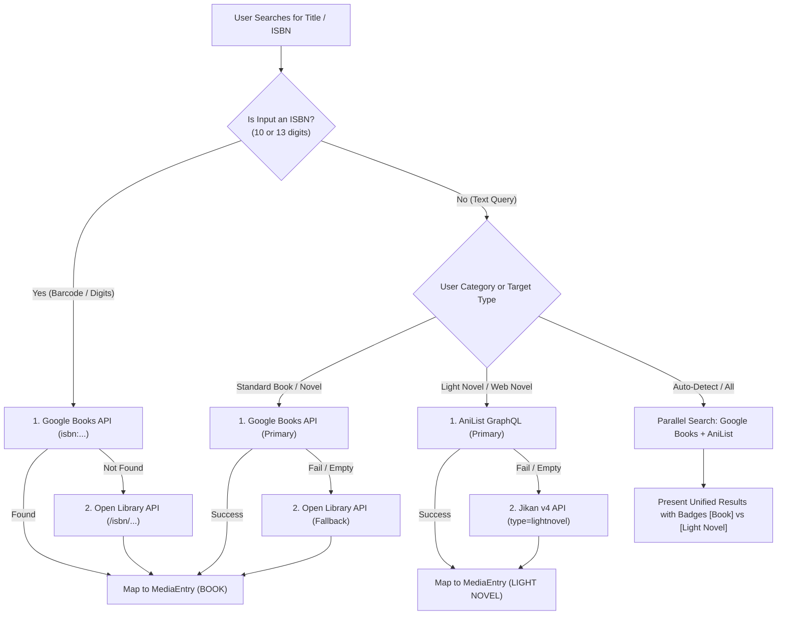

# Books, Novels & Light Novels Metadata API Plan

> **Context for LX Track List:**  
> LX Track List already supports tracking for `BOOK` and custom categories (e.g., "Light Novels", "Web Novels"). However, unlike Movies (TMDB) or Manga (Jikan / MangaDex), written literature is split across two fundamentally different ecosystems:
> 1. **Traditional Books & Western Novels:** Driven by ISBNs, publishers, and page counts (e.g., Brandon Sanderson, George R.R. Martin, Stephen King, non-fiction).
> 2. **Light Novels (Ranobe) & Asian/Serial Web Novels:** Driven by series franchises, volumes, chapters, Romaji/Native titles, and serialized translations (e.g., *Overlord*, *Monogatari*, *Classroom of the Elite*, *Solo Leveling*, *Omniscient Reader*).
>
> This document analyzes all viable **100% free or free-API-key** sources, provides a detailed comparison chart, breaks down pros/cons and implementation steps for each, and outlines a unified dual-pipeline architecture for LX Track List.

---

## Master Comparison Chart

| Source | Target Category | Cost / Tier | API Key Required? | Rate Limit | Cover Images | ISBN Support | Volumes / Chapters | Primary Strengths |
|---|---|---|---|---|---|---|---|---|
| **Google Books API** | Traditional Books & Novels | Free (25k/day) | ⚠️ Optional (Recommended) | 1k/day (no key)<br>25k/day (with free key) | ✅ Yes (Multi-size) | ✅ Excellent | ⚠️ Pages only (Volumes as separate books) | Largest book catalog in the world; fast search; ISBN lookup; official licensed LNs. |
| **Open Library** | Traditional Books & Novels | 100% Free | ❌ No | 100 req/5 min (Fair use) | ✅ Yes (Dedicated CDN) | ✅ Excellent | ⚠️ Pages only | 100% open source; non-profit; no API key; good fallback for ISBNs. |
| **AniList API (GraphQL)** | Light Novels & Web Novels | 100% Free | ❌ No | 90 req/min | ✅ Yes (Extra-large HD) | ❌ Limited | ✅ Full (Volumes + Chapters) | **The best API for Light Novels**; `format: NOVEL`; authors + illustrators; native titles. |
| **Jikan v4 (MAL)** | Light Novels & Japanese Novels | 100% Free | ❌ No | 3 req/sec<br>60 req/min | ✅ Yes (WebP / JPG) | ❌ No | ✅ Full (Volumes + Chapters) | Already integrated in LX Track List; zero setup; MAL IDs; good metadata. |
| **Hardcover API** | Modern Books & Fiction | Free Tier | ✅ Yes (Free key) | 60 req/min | ✅ Yes | ✅ Good | ⚠️ Pages + Series order | Modern Goodreads alternative; first-class series & edition support; clean GraphQL. |
| **Kitsu API** | Light Novels & Manga | 100% Free | ❌ No | Fair use | ✅ Yes | ❌ No | ✅ Full (Volumes + Chapters) | REST alternative to AniList for anime/novel data; clean JSON:API spec. |
| **NovelUpdates (NuAPI / Scraper)** | Asian Web Novels (KR/CN/JP) | Free (Community) | ❌ No | Depends on scraper / proxy | ✅ Yes | ❌ No | ✅ Full (Chapters + Translation status) | Unrivaled catalog of translated web novels, translators, and web serial releases. |
| **Royal Road (RSS / Scraper)** | Western Web Novels & LitRPG | Free | ❌ No | Fair use | ✅ Yes | ❌ No | ✅ Chapters + Pages estimate | King of English web serials (Progression Fantasy, LitRPG, Isekai). |

---

## Detailed Breakdown of Sources

---

### 1. Google Books API — ⭐ Primary Source for Traditional Books

**Base URL:** `https://www.googleapis.com/books/v1`

Google Books is the industry standard for general books, fiction, non-fiction, textbooks, and officially licensed English releases of light novels (Yen Press, Seven Seas, J-Novel Club, Kodansha).

#### Pros
- **Vast Database:** Decades of scanned and publisher-submitted books across all global languages.
- **ISBN Search:** Instant, 100% accurate lookups using ISBN-10 or ISBN-13 (crucial for physical book scanning).
- **High Availability & Speed:** Powered by Google's global CDN infrastructure.
- **Rich Metadata:** Authors, publishers, publication dates, descriptions, categories/genres, page counts, and preview links.
- **Generous Free Quota:** 1,000 queries/day without a key; 25,000 queries/day with a free Google Cloud API key (no credit card required).

#### Cons
- **Light Novels are Fragmented:** Each volume of a light novel is treated as an isolated book rather than a unified series (e.g., *Sword Art Online Vol. 1* and *Vol. 2* have separate entries and separate ISBNs).
- **No Chapter Counts:** Only provides `pageCount`; serial chapters are not tracked.
- **Image URL Quirks:** Image links are returned with `http://` by default (must rewrite to `https://`), and default thumbnails can be low-res unless parameter `zoom=1` or `zoom=2` is adjusted.
- **HTML in Synopses:** Book descriptions frequently contain raw HTML tags (`<b>`, `<i>`, `<p>`) that must be stripped before rendering in Compose.

#### What to Do (Integration Guide)
1. **Get Free API Key:**
   - Go to [Google Cloud Console](https://console.cloud.google.com/).
   - Create a project (e.g., `LX-Track-List`).
   - Enable the **Books API** from the API Library.
   - Under **Credentials**, click **Create Credentials → API Key**.
   - (Optional) Restrict key to `Books API` and Android app package name/SHA-1 fingerprint.
2. **Endpoints to Use:**
   ```http
   # Search by title or author
   GET https://www.googleapis.com/books/v1/volumes?q=intitle:Dune+inauthor:Frank+Herbert&maxResults=5&key={YOUR_API_KEY}

   # Search by ISBN (Barcode scan lookup)
   GET https://www.googleapis.com/books/v1/volumes?q=isbn:9780441172719&key={YOUR_API_KEY}

   # Get volume details by ID
   GET https://www.googleapis.com/books/v1/volumes/{volumeId}?key={YOUR_API_KEY}
   ```
3. **Sample Response:**
   ```json
   {
     "items": [
       {
         "id": "B1hSG44jtDUC",
         "volumeInfo": {
           "title": "Dune",
           "authors": ["Frank Herbert"],
           "publisher": "Ace Books",
           "publishedDate": "1990-09-01",
           "description": "Set on the desert planet Arrakis, Dune is the story of the boy Paul Atreides...",
           "industryIdentifiers": [
             { "type": "ISBN_10", "identifier": "0441172717" },
             { "type": "ISBN_13", "identifier": "9780441172719" }
           ],
           "pageCount": 412,
           "categories": ["Fiction / Science Fiction / Space Opera"],
           "imageLinks": {
             "smallThumbnail": "http://books.google.com/books/content?id=B1hSG44jtDUC&printsec=frontcover&img=1&zoom=5&source=gbs_api",
             "thumbnail": "http://books.google.com/books/content?id=B1hSG44jtDUC&printsec=frontcover&img=1&zoom=1&source=gbs_api"
           },
           "language": "en"
         }
       }
     ]
   }
   ```
4. **Field Mapping → `MediaEntry`:**
   - `id` → `externalId = "GOOGLE_BOOKS_${item.id}"`
   - `volumeInfo.title` → `title`
   - `volumeInfo.authors.joinToString(", ")` → `tags` / notes author header
   - `volumeInfo.industryIdentifiers` (ISBN_13) → `tags` (e.g., `"ISBN: 9780441172719"`)
   - `volumeInfo.pageCount` → `totalPages`
   - `TrackingUnit.PAGES` → `trackingUnit`
   - `volumeInfo.imageLinks.thumbnail.replace("http://", "https://")` → `coverImageUri`
   - `volumeInfo.description` (stripped of HTML tags) → `notes`
   - `volumeInfo.publishedDate` (parsed epoch) → `airedStartDate`

---

### 2. Open Library (Internet Archive) — 🛡️ Free & Open Fallback for Books

**Base URL:** `https://openlibrary.org`

Open Library is an open, editable library catalog funded by the Internet Archive and non-profit grants.

#### Pros
- **Zero API Key / Zero Friction:** Completely open. Make simple GET requests without creating an account or managing secrets.
- **Dedicated Cover Art CDN:** Clean cover URL structure (`covers.openlibrary.org`) that supports ISBN or Open Library ID lookups directly.
- **Community & Archival Depth:** Contains records of older, out-of-print, and rare historical editions that commercial APIs sometimes omit.
- **Offline / Bulk Dumps Available:** Entire datasets can be downloaded locally if desired.

#### Cons
- **Crowdsourced Inconsistencies:** Data quality varies; some entries have missing authors, vague publish dates, or duplicates.
- **Slower Search Response:** Response times can occasionally reach 1.5–3 seconds during peak archival traffic.
- **Not Optimized for Light Novels:** Japanese/Korean light novels are rarely populated or only exist as sparse individual translated editions.

#### What to Do (Integration Guide)
1. **No Registration Required:** You do not need any credentials.
2. **Endpoints to Use:**
   ```http
   # Search books by title or author
   GET https://openlibrary.org/search.json?q=atomic+habits&limit=5

   # Search by ISBN directly
   GET https://openlibrary.org/isbn/9780735211292.json

   # Cover image endpoint (returns high-res image directly)
   GET https://covers.openlibrary.org/b/isbn/9780735211292-L.jpg?default=false
   # (Supports sizes: -S.jpg, -M.jpg, -L.jpg)
   ```
3. **Sample Response (`search.json`):**
   ```json
   {
     "numFound": 1,
     "docs": [
       {
         "key": "/works/OL17930368W",
         "title": "Atomic Habits",
         "author_name": ["James Clear"],
         "first_publish_year": 2018,
         "isbn": ["9780735211292", "9781847941831"],
         "number_of_pages_median": 320,
         "cover_i": 10522434,
         "subject": ["Self-Help", "Habit formation", "Personal development"]
       }
     ]
   }
   ```
4. **Field Mapping → `MediaEntry`:**
   - `docs[0].key` → `externalId = "OPEN_LIBRARY_${key.replace('/works/', '')}"`
   - `docs[0].title` → `title`
   - `docs[0].author_name.firstOrNull()` → notes / author field
   - `docs[0].number_of_pages_median` → `totalPages`
   - `https://covers.openlibrary.org/b/id/${docs[0].cover_i}-L.jpg` → `coverImageUri`
   - `docs[0].first_publish_year` → `airedStartDate`

---

### 3. AniList API (GraphQL) — ⭐ Primary Source for Light Novels & Web Novels

**Base URL:** `https://graphql.anilist.co`

AniList has the cleanest, most comprehensive, and best-maintained database for Japanese Light Novels, Korean Web Novels, and Chinese Web Serials in the world.

#### Pros
- **Dedicated Light Novel Classification:** Light Novels are queried cleanly using `type: MANGA` and `format: NOVEL`. This prevents manga adaptations from being conflated with the original written novel.
- **True Series Franchise Tracking:** Returns the total volume count and total chapter count for the whole series (e.g., *Classroom of the Elite* lists its 14 Year 1 volumes and ongoing status).
- **Separation of Author & Illustrator:** Returns both the original author (Story) and character designer/illustrator (Art).
- **Multilingual Titles:** Returns Romaji, English, and Native Kanji/Hangul/Hanzi titles in one object.
- **Ultra High-Definition Covers & Banners:** `coverImage.extraLarge` provides crisp, high-resolution original art; `bannerImage` provides landscape artwork.
- **No API Key Required:** Fully public GraphQL endpoint with a generous limit of 90 requests/minute.

#### Cons
- **Asian Media Only:** Does not contain standard Western books (no Stephen King, Tolkien, or non-fiction).
- **GraphQL Learning Curve:** Requests require sending a POST body with a GraphQL query string instead of a simple GET URL.

#### What to Do (Integration Guide)
1. **No API Key Needed:** Send `POST` to `https://graphql.anilist.co` with header `Content-Type: application/json`.
2. **GraphQL Query Template:**
   ```graphql
   query SearchLightNovel($search: String) {
     Page(page: 1, perPage: 5) {
       media(search: $search, type: MANGA, format: NOVEL) {
         id
         title {
           romaji
           english
           native
         }
         synonyms
         description(asHtml: false)
         status
         volumes
         chapters
         coverImage {
           extraLarge
           large
         }
         bannerImage
         genres
         tags {
           name
           rank
         }
         staff {
           edges {
             role
             node {
               name {
                 full
               }
             }
           }
         }
         averageScore
         startDate {
           year
           month
           day
         }
         endDate {
           year
           month
           day
         }
       }
     }
   }
   ```
3. **HTTP Request Example (cURL / Retrofit):**
   ```bash
   curl -X POST https://graphql.anilist.co \
     -H "Content-Type: application/json" \
     -d '{"query": "query($s:String){Page(page:1,perPage:1){media(search:$s,type:MANGA,format:NOVEL){id title{romaji english} volumes chapters coverImage{extraLarge} averageScore description(asHtml:false)}}}", "variables": {"s": "Overlord"}}'
   ```
4. **Sample Response:**
   ```json
   {
     "data": {
       "Page": {
         "media": [
           {
             "id": 85145,
             "title": {
               "romaji": "Overlord",
               "english": "Overlord"
             },
             "volumes": 18,
             "chapters": null,
             "coverImage": {
               "extraLarge": "https://s4.anilist.co/file/anilistcdn/media/manga/cover/medium/bx85145-KvZom0tVjYJ8.jpg"
             },
             "averageScore": 84,
             "description": "After a twelve-year run, the popular MMORPG, Yggdrasil, is shutting down..."
           }
         ]
       }
     }
   }
   ```
5. **Field Mapping → `MediaEntry`:**
   - `id` → `externalId = "ANILIST_${media.id}"`
   - `title.english ?: title.romaji` → `title`
   - `title.native ?: title.romaji` → `alternateTitle`
   - `media.volumes` → `totalVolumes`
   - `media.chapters` → `totalChapters`
   - `TrackingUnit.VOLUMES` or `TrackingUnit.CHAPTERS` → `trackingUnit`
   - `coverImage.extraLarge` → `coverImageUri`
   - `description` → `notes`
   - `averageScore / 10f` (scaled to 10.0) → `externalScore`
   - `"AniList"` → `externalScoreSource`

---

### 4. Jikan v4 (Unofficial MyAnimeList API) — 🔄 Familiar Fallback for Light Novels

**Base URL:** `https://api.jikan.moe/v4`

Since LX Track List already utilizes Jikan for Anime and Manga, integrating Light Novels through Jikan requires virtually zero new networking code.

#### Pros
- **Zero Architecture Changes:** Uses the exact same Retrofit setup, models, and JSON parsing logic already in place for Manga.
- **No API Key Required:** Completely free and open REST endpoints.
- **Includes MAL IDs:** Allows seamless cross-referencing with users' MyAnimeList sync accounts.
- **Clean REST Endpoints:** Simple query parameters (`type=lightnovel` or `type=novel`).

#### Cons
- **Rate Limits:** Enforces 3 requests/sec and 60 requests/min. Rapid consecutive queries can trigger HTTP 429.
- **Lacks Korean / Chinese Web Novels:** MAL's submission rules historically rejected web novels unless they received physical published volumes in Japan. As a result, many popular Manhwa web novel originals (e.g., *The Greatest Estate Developer*, *Omniscient Reader*) are absent or delayed.
- **Occasional Community Outages:** Jikan occasionally encounters server strain during peak MAL update cycles.

#### What to Do (Integration Guide)
1. **Endpoints to Use:**
   ```http
   # Search light novels specifically
   GET https://api.jikan.moe/v4/manga?q=Mushoku+Tensei&type=lightnovel&limit=5

   # Search general novels
   GET https://api.jikan.moe/v4/manga?q=Fate/Zero&type=novel&limit=5

   # Lookup single entry by MAL ID
   GET https://api.jikan.moe/v4/manga/{mal_id}/full
   ```
2. **Sample Response:**
   ```json
   {
     "data": [
       {
         "mal_id": 70261,
         "title": "Mushoku Tensei: Isekai Ittara Honki Dasu",
         "title_english": "Mushoku Tensei: Jobless Reincarnation",
         "title_japanese": "無職転生 - 異世界行ったら本気だす -",
         "type": "Light Novel",
         "volumes": 26,
         "chapters": 204,
         "status": "Finished",
         "score": 8.78,
         "synopsis": "Just when an unemployed thirty-four-year-old otaku reaches an absolute dead end...",
         "images": {
           "webp": {
             "large_image_url": "https://cdn.myanimelist.net/images/manga/1/143521l.webp"
           }
         },
         "authors": [
           { "name": "Rifujin na Magonote", "type": "Story" },
           { "name": "Sirotaka", "type": "Art" }
         ]
       }
     ]
   }
   ```
3. **Field Mapping → `MediaEntry`:**
   - `mal_id` → `externalId = "MAL_${data.mal_id}"`
   - `title_english ?: title` → `title`
   - `title_japanese ?: title` → `alternateTitle`
   - `volumes` → `totalVolumes`
   - `chapters` → `totalChapters`
   - `score` → `externalScore`
   - `"MyAnimeList"` → `externalScoreSource`
   - `images.webp.large_image_url` → `coverImageUri`

---

### 5. Hardcover.app API — 💎 Modern Goodreads Alternative for Fiction & Series

**Base URL:** `https://api.hardcover.app/v1/graphql`

Hardcover is a modern, social, open-minded book tracking platform designed to replace legacy Goodreads.

#### Pros
- **True Series Tracking for Standard Books:** Tracks series numbering properly (e.g., *The Way of Kings* is Book 1 of *The Stormlight Archive*).
- **Clean GraphQL Interface:** Request only the fields needed (title, author, editions, covers, ratings).
- **Modern Database:** Rich community-curated data with contemporary tagging (moods, pacing, tropes).

#### Cons
- **Requires Account Registration:** An API key is required (generated for free in user profile settings).
- **Younger Catalog:** While mainstream fiction and fantasy are well covered, obscure non-English or indie books may have less data than Google Books.

#### What to Do (Integration Guide)
1. Register a free account at [hardcover.app](https://hardcover.app).
2. Go to **Settings → API** and generate a Personal Access Token.
3. Use header `Authorization: Bearer <TOKEN>` to POST to `https://api.hardcover.app/v1/graphql`.
4. **Query Example:**
   ```graphql
   query SearchBooks($query: String!) {
     books(where: { title: { _ilike: $query } }, limit: 5) {
       id
       title
       subtitle
       description
       pages
       rating
       image {
         url
       }
       contributions {
         author {
           name
         }
       }
       book_series {
         series_position
         series {
           name
         }
       }
     }
   }
   ```

---

### 6. NovelUpdates (NuAPI / Scraper) — 👑 The Holy Grail for Asian Web Novels

**Base URL:** `https://www.novelupdates.com` (Official site) / Community APIs (e.g., NuAPI)

NovelUpdates is the undisputed standard for English translations of Asian web novels (Korean Wuxia/Murim, Chinese Xianxia, Japanese Syosetu web novels).

#### Pros
- **Unrivaled Granularity for Web Novels:** Tracks original publisher, translator groups, license status, raw chapter counts vs translated chapter counts, release frequency, and associated names.
- **Covers Works Not on MAL or Google Books:** Unofficial web novel translations that have never been physically printed.

#### Cons
- **Cloudflare Protection:** The official site is heavily guarded by Cloudflare bot protection, blocking direct HTTP calls from standard Android clients.
- **No Official API:** Requires scraping, using open-source community proxies (like NuAPI or Tachiyomi/LNReader extension scrapers), or reading user-level RSS feeds.
- **Best as an Optional Advanced / Community Extension:** Due to scraping maintenance, it should supplement rather than serve as the app's default network client.

---

### 7. Royal Road (RSS & Public Endpoints) — 🏰 For Western Web Serials & LitRPG

**Base URL:** `https://www.royalroad.com`

Royal Road hosts the largest collection of popular Western web serials, Progression Fantasy, LitRPG, and GameLit (e.g., *Mother of Learning*, *He Who Fights with Monsters*, *The Primal Hunter*).

#### Pros
- **Comprehensive for Indie & Web Serials:** Many famous Kindle Unlimited / Audible bestsellers originated here.
- **Public RSS Feeds:** Fiction syndication RSS feeds can be consumed without authentication or keys.
- **Covers Chapter Updates in Real Time:** Ideal for following ongoing release schedules.

#### Cons
- **No Official JSON REST API:** Data extraction relies on parsing public RSS feeds or HTML parsing (similar to LNReader/Mihon extractors).

---

## Strategic Recommendation for LX Track List

### The Problem: A Single API Cannot Solve Books & Light Novels
- If you use **Google Books** for *Overlord*, you get Volume 1 as a 250-page book with no knowledge that it belongs to an 18-volume series with an anime adaptation.
- If you use **AniList** for *Dune* or *Atomic Habits*, you get 0 results because it only tracks Asian media.

### The Solution: The Smart Hybrid Pipeline



---

## Kotlin Architecture Blueprint for LX Track List

### 1. Data Models (`BookSearchResult.kt`)

```kotlin
package com.lx.tracklist.data.remote.books

import com.lx.tracklist.data.model.MediaType
import com.lx.tracklist.data.model.TrackingUnit

data class BookSearchResult(
    val externalId: String,
    val externalSource: String, // "GOOGLE_BOOKS", "OPEN_LIBRARY", "ANILIST", "MAL"
    val title: String,
    val alternateTitle: String? = null,
    val authors: List<String> = emptyList(),
    val description: String? = null,
    val coverImageUrl: String? = null,
    val totalPages: Int? = null,
    val totalVolumes: Int? = null,
    val totalChapters: Int? = null,
    val trackingUnit: TrackingUnit = TrackingUnit.PAGES,
    val mediaType: MediaType = MediaType.BOOK,
    val releaseYear: Int? = null,
    val score: Float? = null,
    val isbn: String? = null
)
```

---

### 2. Google Books Retrofit Interface (`GoogleBooksApi.kt`)

```kotlin
package com.lx.tracklist.data.remote.books.google

import retrofit2.http.GET
import retrofit2.http.Path
import retrofit2.http.Query

interface GoogleBooksApi {
    @GET("books/v1/volumes")
    suspend fun searchVolumes(
        @Query("q") query: String,
        @Query("maxResults") maxResults: Int = 10,
        @Query("key") apiKey: String? = null
    ): GoogleBooksResponse

    @GET("books/v1/volumes/{volumeId}")
    suspend fun getVolumeById(
        @Path("volumeId") volumeId: String,
        @Query("key") apiKey: String? = null
    ): GoogleBookItem
}

data class GoogleBooksResponse(
    val totalItems: Int,
    val items: List<GoogleBookItem>?
)

data class GoogleBookItem(
    val id: String,
    val volumeInfo: VolumeInfo
)

data class VolumeInfo(
    val title: String,
    val subtitle: String?,
    val authors: List<String>?,
    val publisher: String?,
    val publishedDate: String?,
    val description: String?,
    val pageCount: Int?,
    val categories: List<String>?,
    val imageLinks: ImageLinks?,
    val industryIdentifiers: List<IndustryIdentifier>?
)

data class ImageLinks(
    val smallThumbnail: String?,
    val thumbnail: String?
)

data class IndustryIdentifier(
    val type: String,
    val identifier: String
)
```

---

### 3. AniList GraphQL Service (`AniListNovelApi.kt`)

```kotlin
package com.lx.tracklist.data.remote.books.anilist

import okhttp3.MediaType.Companion.toMediaType
import okhttp3.OkHttpClient
import okhttp3.Request
import okhttp3.RequestBody.Companion.toRequestBody
import org.json.JSONObject
import javax.inject.Inject
import javax.inject.Singleton

@Singleton
class AniListNovelService @Inject constructor(
    private val okHttpClient: OkHttpClient
) {
    suspend fun searchLightNovels(queryText: String): List<AniListNovelResult> {
        val query = """
            query (${'$'}search: String) {
              Page(page: 1, perPage: 6) {
                media(search: ${'$'}search, type: MANGA, format: NOVEL) {
                  id
                  title {
                    romaji
                    english
                    native
                  }
                  description(asHtml: false)
                  volumes
                  chapters
                  averageScore
                  coverImage {
                    extraLarge
                  }
                  staff {
                    edges {
                      role
                      node {
                        name {
                          full
                        }
                      }
                    }
                  }
                }
              }
            }
        """.trimIndent()

        val jsonBody = JSONObject().apply {
            put("query", query)
            put("variables", JSONObject().put("search", queryText))
        }

        val request = Request.Builder()
            .url("https://graphql.anilist.co")
            .post(jsonBody.toString().toRequestBody("application/json".toMediaType()))
            .build()

        return kotlinx.coroutines.Dispatchers.IO {
            okHttpClient.newCall(request).execute().use { response ->
                if (!response.isSuccessful) return@use emptyList()
                parseAniListResponse(response.body?.string().orEmpty())
            }
        }
    }

    private fun parseAniListResponse(jsonString: String): List<AniListNovelResult> {
        val list = mutableListOf<AniListNovelResult>()
        val root = JSONObject(jsonString)
        val mediaArray = root.optJSONObject("data")
            ?.optJSONObject("Page")
            ?.optJSONArray("media") ?: return emptyList()

        for (i in 0 until mediaArray.length()) {
            val item = mediaArray.getJSONObject(i)
            val titleObj = item.optJSONObject("title")
            val coverObj = item.optJSONObject("coverImage")
            val id = item.getInt("id")
            val titleEn = titleObj?.optString("english")?.takeIf { it.isNotBlank() }
            val titleRomaji = titleObj?.optString("romaji")?.takeIf { it.isNotBlank() }
            val titleNative = titleObj?.optString("native")?.takeIf { it.isNotBlank() }
            val title = titleEn ?: titleRomaji ?: titleNative ?: "Unknown"

            list.add(
                AniListNovelResult(
                    id = id,
                    title = title,
                    alternateTitle = titleNative ?: titleRomaji,
                    volumes = item.optInt("volumes", 0).takeIf { it > 0 },
                    chapters = item.optInt("chapters", 0).takeIf { it > 0 },
                    coverUrl = coverObj?.optString("extraLarge"),
                    synopsis = item.optString("description"),
                    score = item.optInt("averageScore", 0).takeIf { it > 0 }?.toFloat()?.div(10f)
                )
            )
        }
        return list
    }
}

data class AniListNovelResult(
    val id: Int,
    val title: String,
    val alternateTitle: String?,
    val volumes: Int?,
    val chapters: Int?,
    val coverUrl: String?,
    val synopsis: String?,
    val score: Float?
)
```

---

### 4. Unified Fallback Repository (`BookMetadataRepository.kt`)

```kotlin
package com.lx.tracklist.data.repository

import com.lx.tracklist.data.remote.books.BookSearchResult
import com.lx.tracklist.data.remote.books.anilist.AniListNovelService
import com.lx.tracklist.data.remote.books.google.GoogleBooksApi
import com.lx.tracklist.data.model.TrackingUnit
import com.lx.tracklist.data.model.MediaType
import javax.inject.Inject
import javax.inject.Singleton

@Singleton
class BookMetadataRepository @Inject constructor(
    private val googleBooksApi: GoogleBooksApi,
    private val aniListNovelService: AniListNovelService
) {
    /**
     * Unified search supporting both Traditional Books and Light/Web Novels
     */
    suspend fun search(query: String, isLightNovelPreferred: Boolean = false): List<BookSearchResult> {
        val trimmed = query.trim()
        val isIsbn = trimmed.replace("-", "").matches(Regex("^[0-9]{10}([0-9]{3})?$"))

        // 1. Direct ISBN Lookup -> Always route to Google Books / Open Library
        if (isIsbn) {
            return searchGoogleBooks("isbn:$trimmed")
        }

        // 2. Light Novel Preferred / Requested -> Search AniList first
        if (isLightNovelPreferred) {
            val aniListResults = try {
                aniListNovelService.searchLightNovels(trimmed).map { it.toGenericResult() }
            } catch (_: Exception) {
                emptyList()
            }
            if (aniListResults.isNotEmpty()) return aniListResults
        }

        // 3. General Book Search -> Google Books
        val googleResults = searchGoogleBooks(trimmed)
        if (googleResults.isNotEmpty()) return googleResults

        // 4. Fallback to AniList if Google Books returned nothing (handles English LN titles)
        return try {
            aniListNovelService.searchLightNovels(trimmed).map { it.toGenericResult() }
        } catch (_: Exception) {
            emptyList()
        }
    }

    private suspend fun searchGoogleBooks(query: String): List<BookSearchResult> {
        return try {
            val response = googleBooksApi.searchVolumes(query = query, maxResults = 10)
            response.items?.map { item ->
                val info = item.volumeInfo
                val secureCover = info.imageLinks?.thumbnail?.replace("http://", "https://")
                val cleanDescription = info.description?.replace(Regex("<[^>]*>"), "")
                val isbn13 = info.industryIdentifiers?.firstOrNull { it.type == "ISBN_13" }?.identifier

                BookSearchResult(
                    externalId = item.id,
                    externalSource = "GOOGLE_BOOKS",
                    title = info.title,
                    alternateTitle = info.subtitle,
                    authors = info.authors ?: emptyList(),
                    description = cleanDescription,
                    coverImageUrl = secureCover,
                    totalPages = info.pageCount,
                    trackingUnit = TrackingUnit.PAGES,
                    mediaType = MediaType.BOOK,
                    isbn = isbn13
                )
            } ?: emptyList()
        } catch (_: Exception) {
            emptyList()
        }
    }
}
```

---

## Action Items & Implementation Checklist

### Phase 1: Zero-Key Foundations (Immediate)
- [ ] Add `AniListNovelService` to `app/src/main/kotlin/com/lx/tracklist/data/remote/` using the zero-key GraphQL POST endpoint.
- [ ] Add `type=lightnovel` option to existing Jikan search queries as an immediate secondary fallback for anime fans.
- [ ] Add Open Library Covers CDN fallback (`https://covers.openlibrary.org/b/isbn/{isbn}-L.jpg`) when book cover images are missing.

### Phase 2: Google Books Integration (High Coverage)
- [ ] Create free API key in Google Cloud Console for Books API.
- [ ] Implement `GoogleBooksApi` interface with Retrofit.
- [ ] Add HTML tag strip helper (`Regex("<[^>]*>")`) to sanitize Google Books descriptions before saving to `MediaEntry.notes`.
- [ ] Add HTTPS enforcement for all Google Books thumbnail URLs.

### Phase 3: UI & Tracking Unit Polish in Compose
- [ ] In the Add/Edit Media Screen, dynamically switch progress labels:
  - When `trackingUnit == TrackingUnit.PAGES`: show `"Pages: [readPages] / [totalPages]"`.
  - When `trackingUnit == TrackingUnit.VOLUMES`: show `"Volumes: [readVolumes] / [totalVolumes]"`.
  - When `trackingUnit == TrackingUnit.CHAPTERS`: show `"Chapters: [readChapters] / [totalChapters]"`.
- [ ] Add search source toggle or auto-detection pill: `[All]`, `[Books & Novels]`, `[Light Novels]`.

