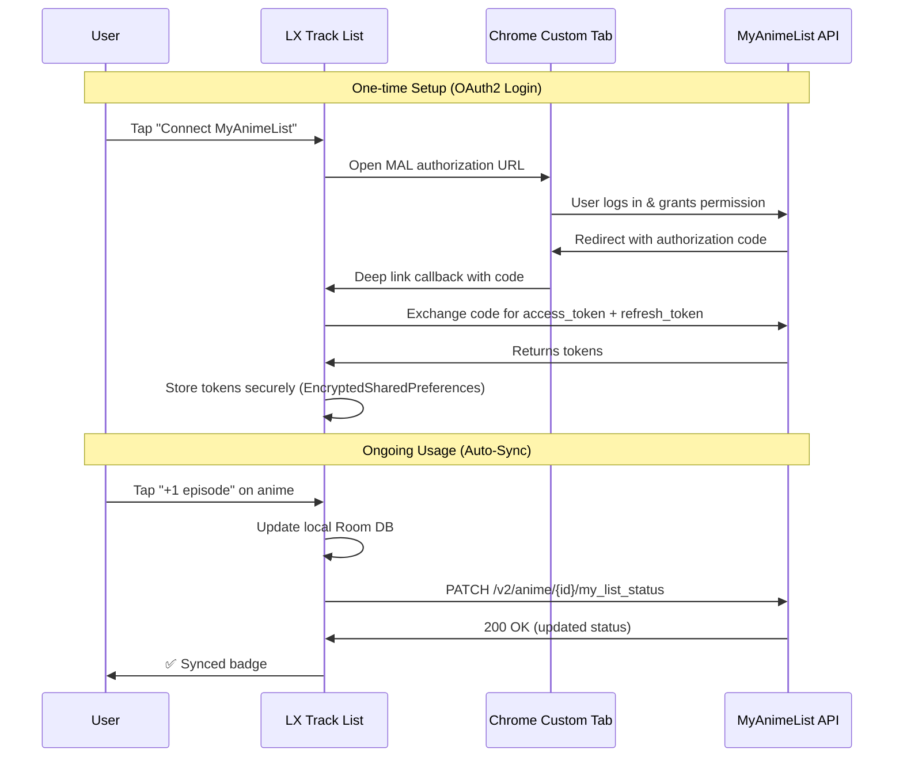
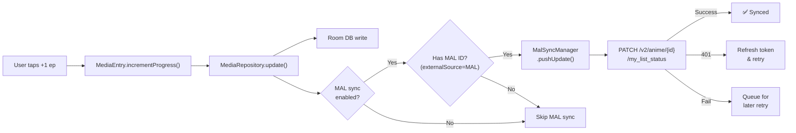

# 🔄 MyAnimeList (MAL) Sync Integration Plan

> **Goal**: Allow users to connect their MyAnimeList account to LX Track List so that when they update progress (e.g. +1 episode), the change is automatically pushed to their MAL profile in real-time.

---

## Table of Contents

1. [Overview & How It Works](#1-overview--how-it-works)
2. [What You Need (Prerequisites)](#2-what-you-need-prerequisites)
3. [MAL API Capabilities & Endpoints](#3-mal-api-capabilities--endpoints)
4. [Architecture](#4-architecture)
5. [Implementation Plan](#5-implementation-plan)
   - [Phase 1: OAuth2 Authentication](#phase-1-oauth2-authentication)
   - [Phase 2: Token Management](#phase-2-token-management)
   - [Phase 3: Sync Engine (Push Updates)](#phase-3-sync-engine-push-updates)
   - [Phase 4: Pull / Import from MAL](#phase-4-pull--import-from-mal)
   - [Phase 5: Settings UI](#phase-5-settings-ui)
6. [Status & Field Mapping](#6-status--field-mapping)
7. [New Files to Create](#7-new-files-to-create)
8. [Files to Modify](#8-files-to-modify)
9. [Dependency Changes](#9-dependency-changes)
10. [Edge Cases & Error Handling](#10-edge-cases--error-handling)
11. [Security Considerations](#11-security-considerations)
12. [Testing Checklist](#12-testing-checklist)
13. [Future Enhancements](#13-future-enhancements)

---

## 1. Overview & How It Works



**Key Principle**: LX Track List remains the **primary source of truth**. MAL sync is a **fire-and-forget push** that runs in the background after every local update. The user never has to wait for MAL sync to complete before continuing to use the app.

---

## 2. What You Need (Prerequisites)

### 2.1 MAL API Client Registration

| Step | Action |
|------|--------|
| 1 | Go to [https://myanimelist.net/apiconfig](https://myanimelist.net/apiconfig) |
| 2 | Click **"Create ID"** to register a new application |
| 3 | Fill in the form: |
| | **App Name**: `LX Track List` |
| | **App Type**: `other` (or `android` if available) |
| | **App Redirect URL**: `lxtracklist://mal-oauth` |
| | **Homepage URL**: `https://github.com/AlexLX4773H/LXTrackList` |
| | **App Description**: Personal media tracker for Android |
| 4 | Submit → You'll receive a **Client ID** |

> [!IMPORTANT]
> Since LX Track List is a native Android app (public client), MAL does **not** issue a `client_secret`. You'll use **OAuth2 with PKCE** instead of client credentials — this is the correct and secure approach for mobile apps.

### 2.2 Key API Details

| Item | Value |
|------|-------|
| **Authorization URL** | `https://myanimelist.net/v1/oauth2/authorize` |
| **Token URL** | `https://myanimelist.net/v1/oauth2/token` |
| **API Base URL** | `https://api.myanimelist.net/v2` |
| **PKCE Method** | `plain` (MAL uses plain, **not** S256) |
| **Redirect URI Scheme** | `lxtracklist://mal-oauth` |
| **Scopes** | None required — MAL grants full access with a valid token |
| **Token Lifetime** | Access token ~31 days, Refresh token ~1 year |

### 2.3 Android Dependencies Needed

```kotlin
// Already in project:
implementation("com.squareup.okhttp3:okhttp:4.12.0")
implementation("com.google.code.gson:gson:2.x")

// New - for secure token storage:
implementation("androidx.security:security-crypto:1.1.0-alpha06")

// New - for Chrome Custom Tabs (OAuth browser flow):
implementation("androidx.browser:browser:1.8.0")
```

---

## 3. MAL API Capabilities & Endpoints

### Endpoints We'll Use

| Action | Method | Endpoint | Body (form-urlencoded) |
|--------|--------|----------|------------------------|
| **Update anime progress** | `PATCH` | `/v2/anime/{anime_id}/my_list_status` | `status`, `num_watched_episodes`, `score`, `is_rewatching`, `num_times_rewatched` |
| **Update manga progress** | `PATCH` | `/v2/manga/{manga_id}/my_list_status` | `status`, `num_volumes_read`, `num_chapters_read`, `score`, `is_rereading`, `num_times_reread` |
| **Get anime list** | `GET` | `/v2/users/@me/animelist` | Query: `status`, `sort`, `limit`, `offset`, `fields` |
| **Get manga list** | `GET` | `/v2/users/@me/mangalist` | Query: `status`, `sort`, `limit`, `offset`, `fields` |
| **Get user info** | `GET` | `/v2/users/@me` | Query: `fields` |
| **Search anime** | `GET` | `/v2/anime?q={query}` | Query: `q`, `limit`, `fields` |
| **Delete anime from list** | `DELETE` | `/v2/anime/{anime_id}/my_list_status` | — |

> [!NOTE]
> All requests require the header `Authorization: Bearer <access_token>`. The body must be `application/x-www-form-urlencoded` (not JSON) for PATCH/PUT operations.

---

## 4. Architecture

### Where MAL Sync Fits in the Existing Codebase

```
app/src/main/kotlin/com/lx/tracklist/
├── data/
│   ├── remote/
│   │   ├── JikanApiClient.kt          ← existing (read-only, no auth)
│   │   ├── TmdbApiClient.kt           ← existing
│   │   ├── mal/                        ← NEW PACKAGE
│   │   │   ├── MalAuthManager.kt       ← OAuth2 + PKCE + token storage
│   │   │   ├── MalApiClient.kt         ← MAL API v2 HTTP client
│   │   │   ├── MalSyncManager.kt       ← Orchestrates push/pull sync
│   │   │   └── MalTokenStore.kt        ← EncryptedSharedPreferences wrapper
│   │   └── ...
│   ├── repository/
│   │   └── MediaRepository.kt          ← MODIFY: hook sync after updates
│   └── model/
│       └── MediaEntry.kt               ← existing (already has externalId + externalSource)
├── ui/
│   ├── settings/
│   │   └── SettingsScreen.kt           ← MODIFY: add MAL connection section
│   └── components/
│       └── MalSyncStatusIndicator.kt   ← NEW: small sync badge on cards
└── AndroidManifest.xml                  ← MODIFY: add deep link intent filter
```

### Data Flow for Progress Update



---

## 5. Implementation Plan

### Phase 1: OAuth2 Authentication

#### 1.1 `MalTokenStore.kt` — Secure Token Storage

```kotlin
// data/remote/mal/MalTokenStore.kt
class MalTokenStore(context: Context) {
    private val prefs = EncryptedSharedPreferences.create(
        "mal_tokens",
        MasterKey.Builder(context).setKeyScheme(MasterKey.KeyScheme.AES256_GCM).build(),
        context,
        EncryptedSharedPreferences.PrefKeyEncryptionScheme.AES256_SIV,
        EncryptedSharedPreferences.PrefValueEncryptionScheme.AES256_GCM
    )

    var accessToken: String?
        get() = prefs.getString("access_token", null)
        set(value) = prefs.edit().putString("access_token", value).apply()

    var refreshToken: String?
        get() = prefs.getString("refresh_token", null)
        set(value) = prefs.edit().putString("refresh_token", value).apply()

    var expiresAt: Long
        get() = prefs.getLong("expires_at", 0L)
        set(value) = prefs.edit().putLong("expires_at", value).apply()

    var malUsername: String?
        get() = prefs.getString("mal_username", null)
        set(value) = prefs.edit().putString("mal_username", value).apply()

    val isLoggedIn: Boolean get() = !accessToken.isNullOrBlank()

    fun clear() = prefs.edit().clear().apply()
}
```

#### 1.2 `MalAuthManager.kt` — OAuth2 PKCE Flow

Key responsibilities:
- Generate `code_verifier` (128-char random string)
- Build authorization URL with `code_challenge_method=plain`
- Exchange authorization code for tokens via `POST /v1/oauth2/token`
- Refresh expired tokens via `grant_type=refresh_token`

```kotlin
// data/remote/mal/MalAuthManager.kt
object MalAuthManager {
    const val CLIENT_ID = "YOUR_MAL_CLIENT_ID"  // Load from BuildConfig
    const val REDIRECT_URI = "lxtracklist://mal-oauth"
    private const val AUTH_URL = "https://myanimelist.net/v1/oauth2/authorize"
    private const val TOKEN_URL = "https://myanimelist.net/v1/oauth2/token"

    private var codeVerifier: String? = null

    fun buildAuthUrl(): Uri {
        // Generate code verifier (43-128 chars, unreserved URI chars)
        val verifier = (1..128).map {
            "ABCDEFGHIJKLMNOPQRSTUVWXYZabcdefghijklmnopqrstuvwxyz0123456789-._~".random()
        }.joinToString("")
        codeVerifier = verifier

        return Uri.Builder()
            .scheme("https")
            .authority("myanimelist.net")
            .path("/v1/oauth2/authorize")
            .appendQueryParameter("response_type", "code")
            .appendQueryParameter("client_id", CLIENT_ID)
            .appendQueryParameter("code_challenge", verifier)       // plain method
            .appendQueryParameter("code_challenge_method", "plain") // MAL requires plain!
            .appendQueryParameter("redirect_uri", REDIRECT_URI)
            .build()
    }

    suspend fun exchangeCode(code: String, context: Context): Result<Unit>
    suspend fun refreshToken(context: Context): Result<Unit>
}
```

#### 1.3 AndroidManifest Deep Link

```xml
<!-- Inside <activity android:name=".MainActivity"> -->
<intent-filter>
    <action android:name="android.intent.action.VIEW" />
    <category android:name="android.intent.category.DEFAULT" />
    <category android:name="android.intent.category.BROWSABLE" />
    <data android:scheme="lxtracklist" android:host="mal-oauth" />
</intent-filter>
```

#### 1.4 Handle the Callback in `MainActivity.kt`

```kotlin
// In MainActivity.kt, inside onCreate or onNewIntent:
override fun onNewIntent(intent: Intent) {
    super.onNewIntent(intent)
    val uri = intent.data
    if (uri != null && uri.scheme == "lxtracklist" && uri.host == "mal-oauth") {
        val code = uri.getQueryParameter("code")
        if (code != null) {
            // Pass code to SettingsViewModel to exchange for tokens
            settingsViewModel.handleMalAuthCode(code)
        }
    }
}
```

---

### Phase 2: Token Management

#### 2.1 Auto-Refresh Logic

```kotlin
// Inside MalApiClient - wrap every API call with this
private suspend fun <T> authenticatedRequest(
    context: Context,
    block: suspend (token: String) -> T
): Result<T> {
    val store = MalTokenStore(context)

    // Check if token is expired (with 5-min buffer)
    if (store.expiresAt - System.currentTimeMillis() < 300_000) {
        MalAuthManager.refreshToken(context).onFailure {
            return Result.failure(it)
        }
    }

    val token = store.accessToken ?: return Result.failure(Exception("Not logged in"))

    return try {
        Result.success(block(token))
    } catch (e: HttpException) {
        if (e.code == 401) {
            // Token invalid, try refresh once
            MalAuthManager.refreshToken(context).onFailure {
                return Result.failure(it)
            }
            val newToken = store.accessToken ?: return Result.failure(Exception("Refresh failed"))
            Result.success(block(newToken))
        } else {
            Result.failure(e)
        }
    }
}
```

---

### Phase 3: Sync Engine (Push Updates)

This is the core feature — pushing local changes to MAL.

#### 3.1 `MalApiClient.kt` — HTTP Client

```kotlin
// data/remote/mal/MalApiClient.kt
object MalApiClient {
    private const val BASE_URL = "https://api.myanimelist.net/v2"
    private val client = OkHttpClient.Builder()
        .connectTimeout(15, TimeUnit.SECONDS)
        .readTimeout(15, TimeUnit.SECONDS)
        .build()

    /**
     * Update anime progress on MAL.
     * PATCH https://api.myanimelist.net/v2/anime/{anime_id}/my_list_status
     */
    suspend fun updateAnimeStatus(
        malAnimeId: Long,
        accessToken: String,
        status: String?,                // "watching", "completed", "on_hold", "dropped", "plan_to_watch"
        numWatchedEpisodes: Int?,
        score: Int?,                    // 0-10
        isRewatching: Boolean? = null,
        numTimesRewatched: Int? = null
    ): Result<Unit> = withContext(Dispatchers.IO) {
        val formBody = FormBody.Builder()
        status?.let { formBody.add("status", it) }
        numWatchedEpisodes?.let { formBody.add("num_watched_episodes", it.toString()) }
        score?.let { formBody.add("score", it.toString()) }
        isRewatching?.let { formBody.add("is_rewatching", it.toString()) }
        numTimesRewatched?.let { formBody.add("num_times_rewatched", it.toString()) }

        val request = Request.Builder()
            .url("$BASE_URL/anime/$malAnimeId/my_list_status")
            .patch(formBody.build())
            .header("Authorization", "Bearer $accessToken")
            .build()

        try {
            val response = client.newCall(request).execute()
            if (response.isSuccessful) Result.success(Unit)
            else Result.failure(Exception("MAL API error: ${response.code}"))
        } catch (e: Exception) {
            Result.failure(e)
        }
    }

    /**
     * Update manga progress on MAL.
     * PATCH https://api.myanimelist.net/v2/manga/{manga_id}/my_list_status
     */
    suspend fun updateMangaStatus(
        malMangaId: Long,
        accessToken: String,
        status: String?,
        numVolumesRead: Int?,
        numChaptersRead: Int?,
        score: Int?,
        isRereading: Boolean? = null,
        numTimesReread: Int? = null
    ): Result<Unit>

    /** Pull user's full anime list from MAL */
    suspend fun getAnimeList(accessToken: String, status: String? = null): Result<List<MalAnimeEntry>>

    /** Pull user's full manga list from MAL */
    suspend fun getMangaList(accessToken: String, status: String? = null): Result<List<MalMangaEntry>>
}
```

#### 3.2 `MalSyncManager.kt` — Orchestrator

```kotlin
// data/remote/mal/MalSyncManager.kt
object MalSyncManager {

    /**
     * Called after every local update to MediaEntry.
     * Decides whether to push to MAL based on:
     *   1. User has connected MAL (token exists)
     *   2. Entry has externalSource = "MAL" and a valid externalId
     *   3. Entry is Anime or Manga type
     */
    suspend fun pushIfNeeded(entry: MediaEntry, context: Context) {
        val store = MalTokenStore(context)
        if (!store.isLoggedIn) return
        if (entry.externalSource?.uppercase() != "MAL" && entry.externalSource?.uppercase() != "MYANIMELIST") return
        val malId = entry.externalId?.toLongOrNull() ?: return

        val token = store.accessToken ?: return

        when (entry.mediaType) {
            MediaType.ANIME -> {
                MalApiClient.updateAnimeStatus(
                    malAnimeId = malId,
                    accessToken = token,
                    status = mapStatusToMal(entry.status, isAnime = true),
                    numWatchedEpisodes = entry.currentEpisodes,
                    score = entry.score,
                    isRewatching = entry.isRewatching,
                    numTimesRewatched = entry.rewatchCount
                )
            }
            MediaType.MANGA, MediaType.MANHWA -> {
                MalApiClient.updateMangaStatus(
                    malMangaId = malId,
                    accessToken = token,
                    status = mapStatusToMal(entry.status, isAnime = false),
                    numVolumesRead = entry.currentVolumes,
                    numChaptersRead = entry.currentChapters,
                    score = entry.score,
                    isRereading = entry.isRewatching,
                    numTimesReread = entry.rewatchCount
                )
            }
            else -> { /* Movies, Shows, Books — not on MAL, skip */ }
        }
    }

    private fun mapStatusToMal(status: MediaStatus, isAnime: Boolean): String {
        return when (status) {
            MediaStatus.WATCHING -> if (isAnime) "watching" else "reading"
            MediaStatus.COMPLETED -> "completed"
            MediaStatus.ON_HOLD -> "on_hold"
            MediaStatus.DROPPED -> "dropped"
            MediaStatus.PLAN_TO_WATCH -> if (isAnime) "plan_to_watch" else "plan_to_read"
        }
    }
}
```

#### 3.3 Hook into `MediaRepository.kt`

The key change — call `MalSyncManager.pushIfNeeded()` after every write operation:

```kotlin
// In MediaRepository.kt, modify the update() and incrementProgress() functions:

suspend fun update(entry: MediaEntry) {
    val effectiveEntry = if (entry.userId <= 0L) {
        val existing = dao.getEntryByIdSync(entry.id)
        entry.copy(userId = existing?.userId ?: _activeUser.value.id)
    } else {
        entry
    }
    dao.update(effectiveEntry)

    // NEW: Push to MAL in background (fire-and-forget)
    context?.let { ctx ->
        repoScope.launch {
            try { MalSyncManager.pushIfNeeded(effectiveEntry, ctx) } catch (_: Exception) {}
        }
    }
}

suspend fun incrementProgress(entry: MediaEntry): MediaEntry {
    val updated = entry.incrementProgress()
    dao.update(updated)

    // NEW: Push to MAL in background
    context?.let { ctx ->
        repoScope.launch {
            try { MalSyncManager.pushIfNeeded(updated, ctx) } catch (_: Exception) {}
        }
    }

    return updated
}
```

---

### Phase 4: Pull / Import from MAL

Optionally, allow users to pull their full MAL list into LX Track List.

```kotlin
// In MalSyncManager.kt
suspend fun pullFullList(context: Context, repository: MediaRepository): Pair<Int, Int> {
    val store = MalTokenStore(context)
    val token = store.accessToken ?: throw Exception("Not logged in to MAL")

    val animeList = MalApiClient.getAnimeList(token).getOrThrow()
    val mangaList = MalApiClient.getMangaList(token).getOrThrow()

    val entries = mutableListOf<MediaEntry>()

    for (anime in animeList) {
        entries.add(anime.toMediaEntry())  // Map MAL fields → MediaEntry
    }
    for (manga in mangaList) {
        entries.add(manga.toMediaEntry())
    }

    return repository.importEntries(entries, ConflictStrategy.MERGE)
}
```

---

### Phase 5: Settings UI

Add a **"Tracking Services"** section in the Settings screen:

```
┌─────────────────────────────────────────┐
│ 🔗 Tracking Services                    │
├─────────────────────────────────────────┤
│                                         │
│  ┌─ MyAnimeList ──────────────────────┐ │
│  │  Status: ✅ Connected as @Username │ │
│  │                                     │ │
│  │  [🔄 Sync Now]  [❌ Disconnect]   │ │
│  │                                     │ │
│  │  ☑ Auto-sync on progress update   │ │
│  │  ☐ Auto-sync score changes        │ │
│  │  ☐ Auto-sync status changes       │ │
│  └─────────────────────────────────────┘ │
│                                         │
│  ┌─ AniList ──────────────────────────┐ │
│  │  Status: ⬚ Not connected          │ │
│  │  [🔗 Connect AniList]  (Future)   │ │
│  └─────────────────────────────────────┘ │
│                                         │
└─────────────────────────────────────────┘
```

---

## 6. Status & Field Mapping

### LX Track List → MAL Status Mapping

| LX Track List `MediaStatus` | MAL Anime Status | MAL Manga Status |
|------------------------------|------------------|------------------|
| `WATCHING` | `watching` | `reading` |
| `COMPLETED` | `completed` | `completed` |
| `ON_HOLD` | `on_hold` | `on_hold` |
| `DROPPED` | `dropped` | `dropped` |
| `PLAN_TO_WATCH` | `plan_to_watch` | `plan_to_read` |

### Field Mapping (Push)

| LX Track List Field | MAL Anime Field | MAL Manga Field |
|---------------------|-----------------|-----------------|
| `currentEpisodes` | `num_watched_episodes` | — |
| `currentChapters` | — | `num_chapters_read` |
| `currentVolumes` | — | `num_volumes_read` |
| `score` (0-10) | `score` (0-10) | `score` (0-10) |
| `status` | `status` | `status` |
| `isRewatching` | `is_rewatching` | `is_rereading` |
| `rewatchCount` | `num_times_rewatched` | `num_times_reread` |

### Which Media Types Sync?

| LX Media Type | Syncs to MAL? | Notes |
|---------------|---------------|-------|
| **Anime** | ✅ Yes | Full sync (episodes, status, score) |
| **Manga** | ✅ Yes | Full sync (chapters, volumes, status, score) |
| **Manhwa** | ✅ Yes | MAL has manhwa under manga; sync as manga |
| **Movie** | ❌ No | MAL tracks anime movies under anime — only if `externalSource=MAL` |
| **Show** | ❌ No | Live-action not on MAL |
| **Book** | ❌ No | Light novels only if `externalSource=MAL` |

> [!TIP]
> Entries imported from MAL or added via Jikan search already have `externalId` and `externalSource="MAL"` set. These are the ones that will automatically sync. Manually-added entries without a MAL ID won't sync (the user can manually link them to a MAL ID in the future).

---

## 7. New Files to Create

| File | Purpose |
|------|---------|
| `data/remote/mal/MalTokenStore.kt` | EncryptedSharedPreferences wrapper for OAuth tokens |
| `data/remote/mal/MalAuthManager.kt` | OAuth2 PKCE authorization flow + token exchange/refresh |
| `data/remote/mal/MalApiClient.kt` | HTTP client for MAL API v2 (PATCH/GET/DELETE) |
| `data/remote/mal/MalSyncManager.kt` | Orchestrator: decides when and what to sync |
| `data/remote/mal/MalDataModels.kt` | Data classes for MAL API responses (MalAnimeEntry, etc.) |
| `ui/components/MalSyncStatusIndicator.kt` | Small Composable showing sync state on media cards |

---

## 8. Files to Modify

| File | Changes |
|------|---------|
| `AndroidManifest.xml` | Add deep link `<intent-filter>` for `lxtracklist://mal-oauth` |
| `app/build.gradle.kts` | Add `MAL_CLIENT_ID` BuildConfig field + new dependencies |
| `.env.example` | Add `MAL_CLIENT_ID=your_client_id_here` |
| `data/repository/MediaRepository.kt` | Hook `MalSyncManager.pushIfNeeded()` into `update()` and `incrementProgress()` |
| `ui/settings/SettingsScreen.kt` | Add "Tracking Services" section with MAL connect/disconnect |
| `ui/settings/SettingsViewModel.kt` | Add MAL auth state, connect/disconnect actions |
| `MainActivity.kt` | Handle `onNewIntent` for OAuth callback deep link |
| `ui/edit/AddEditViewModel.kt` | Trigger sync after saving edits |
| `ui/detail/DetailScreen.kt` | Show MAL sync indicator |

---

## 9. Dependency Changes

Add to `app/build.gradle.kts`:

```kotlin
// Secure token storage (EncryptedSharedPreferences)
implementation("androidx.security:security-crypto:1.1.0-alpha06")

// Chrome Custom Tabs for OAuth browser flow
implementation("androidx.browser:browser:1.8.0")
```

Add to `app/build.gradle.kts` `defaultConfig` block:

```kotlin
val malClientId = envProperties.getProperty("MAL_CLIENT_ID") ?: ""
buildConfigField("String", "MAL_CLIENT_ID", "\"$malClientId\"")
```

Add to `.env`:

```properties
MAL_CLIENT_ID=your_mal_client_id_here
```

---

## 10. Edge Cases & Error Handling

| Scenario | Handling |
|----------|----------|
| **No internet** | Catch network errors silently; local update succeeds, sync fails gracefully. Optionally queue for retry. |
| **Token expired** | Auto-refresh using `refresh_token`. If refresh fails, mark as disconnected and prompt user to re-login. |
| **Refresh token expired** (~1 year) | Clear tokens, show "MAL session expired, please reconnect" toast. |
| **Entry has no MAL ID** | Skip sync silently. Only entries with `externalSource="MAL"` and valid `externalId` are synced. |
| **MAL rate limit** (429) | Back off with exponential delay. MAL allows ~1 request/second. |
| **Manhwa on MAL** | MAL treats manhwa as manga. Sync using manga endpoints. |
| **Score = null** | Don't send `score` parameter (MAL interprets 0 as "no score"). |
| **User disconnects MAL** | Clear tokens from EncryptedSharedPreferences. Stop all sync. Local data is unaffected. |
| **Multiple profiles** | Store MAL tokens per `UserProfile.id`. Each profile can have its own MAL connection. |

---

## 11. Security Considerations

> [!CAUTION]
> - **Never hardcode the Client ID in source code** — load from `BuildConfig` which reads from `.env`.
> - **Use EncryptedSharedPreferences** for token storage — never plain SharedPreferences.
> - **Never log access tokens** in debug builds.
> - **PKCE with `plain`** is mandated by MAL — this is less secure than S256 but is MAL's requirement. The OAuth flow is still safe because the code verifier is generated fresh per session and transmitted only over HTTPS.
> - **`.env` is in `.gitignore`** — ensure it stays there so Client IDs aren't committed.

---

## 12. Testing Checklist

- [ ] **OAuth Flow**: User can connect MAL account via Chrome Custom Tab
- [ ] **Token Storage**: Tokens persist across app restarts
- [ ] **Token Refresh**: Expired access tokens auto-refresh seamlessly
- [ ] **Episode +1**: Incrementing an anime episode pushes update to MAL
- [ ] **Chapter +1**: Incrementing a manga chapter pushes update to MAL
- [ ] **Status Change**: Changing status (e.g. Watching → Completed) syncs to MAL
- [ ] **Score Update**: Editing score syncs to MAL
- [ ] **No MAL ID**: Entries without `externalSource=MAL` don't trigger any network calls
- [ ] **Offline**: App works normally offline; sync silently fails
- [ ] **Disconnect**: User can disconnect MAL; tokens are cleared
- [ ] **Multi-profile**: Each user profile has independent MAL connection
- [ ] **Rate limiting**: Rapid +1 taps don't flood MAL API (debounce/throttle)

---

## 13. Future Enhancements

| Feature | Description |
|---------|-------------|
| **AniList sync** | Same pattern but with AniList's GraphQL API + OAuth2 |
| **Two-way sync** | Periodically pull from MAL and merge changes (currently push-only) |
| **Conflict resolution UI** | Show diff when MAL and local data disagree |
| **Bulk initial sync** | On first connect, option to push entire library to MAL |
| **Sync queue with retry** | Persist failed syncs to Room and retry on next app launch |
| **Sync history log** | Show users what was synced and when |
| **MAL ID auto-matching** | For manually-added entries, search MAL and let user pick the match |

---

> [!NOTE]
> **Estimated Effort**: ~5-7 days for full implementation
> - Phase 1 (OAuth): ~1.5 days
> - Phase 2 (Tokens): ~0.5 days
> - Phase 3 (Push Sync): ~1.5 days
> - Phase 4 (Pull): ~1 day
> - Phase 5 (Settings UI): ~1 day
> - Testing & polish: ~1 day

