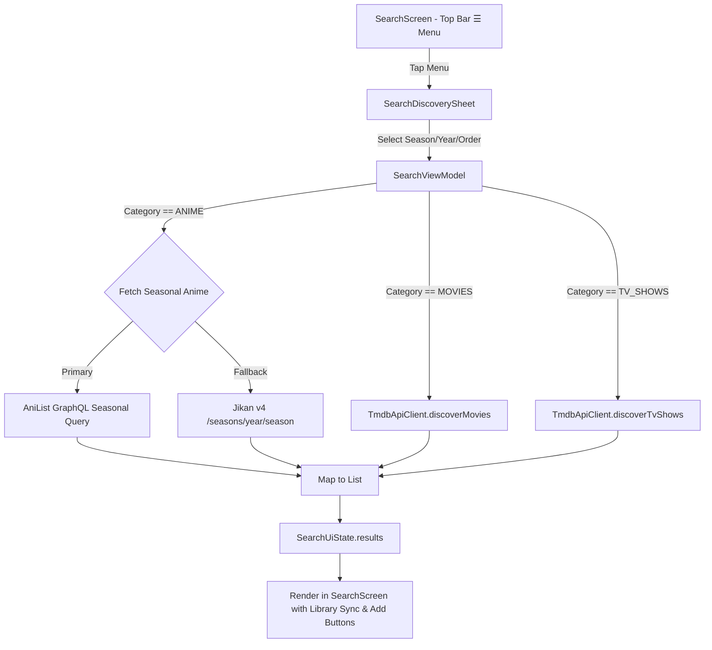

# Seasonal Anime & Media Discovery Plan for LX Track List

> **Scope:** Architecture and implementation plan for adding Seasonal Anime discovery and Year/Sort-based Movie and TV Show discovery from the Search Tab.
> **Date:** November 2026  
> **Status:** Draft / Ready for Implementation

---

## 1. Overview & Objectives

LX Track List currently features keyword search across Anime, Manga, Manhwa, Movies, TV Shows, Books, and Light Novels.

The user requirement is to introduce a **Discovery Mode** accessed via a **Hamburger Menu icon (`☰`) at the top-left of the Search Tab**:
1. **Seasonal Anime (when Anime is selected):**
   - Filter anime by **Season** (Winter, Spring, Summer, Fall).
   - Filter by **Year** (e.g., 2025, 2024, ..., 1990).
   - Order by **Popularity**, **Score / Rating**, **Air Date**, or **Title**.
2. **Movies & TV Shows (when Movies or TV Shows is selected):**
   - Filter by **Release / First Air Year**.
   - Order by **Popularity**, **Highest Rated**, **Release Date**, or **Revenue / Box Office** (Movies).
3. **Category-Adaptive Visibility:**
   - The Hamburger menu options dynamically adjust based on the currently selected search category.
   - When categories without seasonal/discover support are selected, the menu icon is hidden or displays appropriate category discovery.

---

## 2. API Capabilities & Endpoints

### 2.1 Seasonal Anime APIs

The app already integrates **Jikan (MAL)** and **AniList GraphQL** within `JikanApiClient.kt`. Both APIs natively provide seasonal anime data.

#### Primary Provider: AniList GraphQL
- **Why AniList as Primary:** High rate limit headroom, no 3-request/second throttle like Jikan, and direct server-side sorting.
- **Endpoint:** `POST https://graphql.anilist.co`
- **GraphQL Query:**
  ```graphql
  query ($season: MediaSeason, $seasonYear: Int, $sort: [MediaSort], $page: Int, $perPage: Int) {
    Page(page: $page, perPage: $perPage) {
      pageInfo {
        hasNextPage
        total
      }
      media(season: $season, seasonYear: $seasonYear, type: ANIME, sort: $sort) {
        id
        idMal
        title { romaji english native }
        coverImage { extraLarge large }
        episodes
        duration
        format
        status
        averageScore
        description(asHtml: false)
        startDate { year month day }
        genres
        isAdult
      }
    }
  }
  ```
- **Seasons:** `WINTER`, `SPRING`, `SUMMER`, `FALL`.
- **Sorting Options (`$sort`):**
  - `POPULARITY_DESC` (Most Popular)
  - `SCORE_DESC` (Highest Rated)
  - `START_DATE_DESC` (Air Date)
  - `FAVOURITES_DESC` (Most Favorited)
  - `TITLE_ROMAJI` (Alphabetical A–Z)

#### Secondary / Fallback Provider: Jikan API v4
- **Endpoint:** `GET https://api.jikan.moe/v4/seasons/{year}/{season}`
  - Example: `https://api.jikan.moe/v4/seasons/2024/fall?page=1&limit=25`
- **Convenience Routes:**
  - `GET https://api.jikan.moe/v4/seasons/now` (Current season)
  - `GET https://api.jikan.moe/v4/seasons/upcoming` (Upcoming season)
- **Parameters:** `filter=tv|movie|ova|ona`, `page`, `limit`, `sfw=true`.
- **Sorting Strategy:** Jikan returns items ranked by MAL member popularity. Client-side sorting will re-order the batch by score or air date if requested.

---

### 2.2 TMDB Discover APIs (Movies & TV Shows)

`TmdbApiClient.kt` already supports authenticated TMDB calls, fallback base URLs, and DoH (DNS over HTTPS). TMDB provides first-party `/discover` endpoints with year filtering and sorting.

#### Movies: `GET /3/discover/movie`
- **Authentication:** TMDB Bearer Token / API Key from `TmdbConfig.getAccessToken()`.
- **Query Parameters:**
  - `primary_release_year`: 4-digit integer (e.g. `2024`).
  - `sort_by`:
    - `popularity.desc` (Most Popular — default)
    - `vote_average.desc` (Highest Rated)
    - `primary_release_date.desc` (Newest First)
    - `revenue.desc` (Box Office / Highest Grossing)
  - `vote_count.gte`: `50` (Crucial when sorting by `vote_average.desc` so obscure 1-vote films do not flood the top).
  - `include_adult`: `false`.
  - `page`: `1` (supports pagination up to total pages).

#### TV Shows: `GET /3/discover/tv`
- **Authentication:** TMDB Bearer Token / API Key.
- **Query Parameters:**
  - `first_air_date_year`: 4-digit integer (e.g. `2024`).
  - `sort_by`:
    - `popularity.desc` (Most Popular — default)
    - `vote_average.desc` (Highest Rated)
    - `first_air_date.desc` (Newest First)
  - `vote_count.gte`: `20`.
  - `include_adult`: `false`.
  - `page`: `1`.

Both endpoints return TMDB's standard movie/TV results array, which maps directly into `TmdbSearchResult` and `SearchResultItem`.

---

## 3. UI & UX Architecture

### 3.1 Top App Bar with Hamburger Menu
Currently, `SearchScreen.kt` has:
```kotlin
TopAppBar(
    navigationIcon = { UserAvatarButton(activeUser = activeUser, onClick = onUserAvatarClick) },
    title = { Text("Search & Discover") }
)
```

**Proposed Layout:**
A compact `Row` in `navigationIcon` containing the Hamburger Menu icon button alongside the `UserAvatarButton`:
```
+-----------------------------------------------------------+
| [☰] (Avatar)  Search & Discover                           |
|                                                           |
| [ Anime ]  [ Manga ]  [ Manhwa ]  [ Movies ]  [ TV Shows ]|
|                                                           |
| [ Search titles or explore seasons...                   ] |
|                                                           |
| [Filter Active: 🍂 Fall 2024 • Most Popular  (✕)]          |
|                                                           |
| [ ══ Result Cards (with Add to Library & Preview) ══ ]    |
+-----------------------------------------------------------+
```
- **Visibility:** 
  - Shown prominently when `Anime`, `Movies`, or `TV Shows` are selected.
  - An animated badge or subtle highlight on `[☰]` indicates when a discovery filter is active.

---

### 3.2 Discovery Bottom Sheet (`SearchDiscoverySheet.kt`)
Tapping `[☰]` opens a styled `ModalBottomSheet`:

```
+-------------------------------------------------------------+
|                     ─── Drag Handle ───                     |
|                                                             |
|  Seasonal Anime Discovery                      [Reset]      |
|                                                             |
|  Season                                                     |
|  [ ❄️ Winter ]  [ 🌸 Spring ]  [ ☀️ Summer ]  [ 🍂 Fall ]   |
|  [ ⚡ Current Season ]  [ 🚀 Upcoming ]                     |
|                                                             |
|  Year                                                       |
|  [ 2026 ]  [ 2025 ]  [ 2024 ]  [ 2023 ]  [ Other ▼ ]        |
|                                                             |
|  Sort By                                                    |
|  (•) Most Popular                                           |
|  ( ) Highest Rated                                          |
|  ( ) Air Date / Newest                                      |
|  ( ) Title (A–Z)                                            |
|                                                             |
|  [ Apply & Discover Anime ]                                 |
+-------------------------------------------------------------+
```

When **Movies** or **TV Shows** are selected, the sheet dynamically switches:
```
+-------------------------------------------------------------+
|  Discover Movies (TMDB)                        [Reset]      |
|                                                             |
|  Release Year                                               |
|  [ 2025 ]  [ 2024 ]  [ 2023 ]  [ 2022 ]  [ Select Year ▼ ]  |
|                                                             |
|  Sort By                                                    |
|  (•) Most Popular                                           |
|  ( ) Highest Rated                                          |
|  ( ) Release Date                                           |
|  ( ) Box Office / Revenue                                   |
|                                                             |
|  [ Apply & Discover Movies ]                                |
+-------------------------------------------------------------+
```

---

### 3.3 Active Filter Banner
When discovery mode is active:
- An active pill badge appears above the results:
  - `🍂 Fall 2024 • Popular [✕]` or `🎬 Movies 2024 • Highest Rated [✕]`
- Tapping `[✕]` instantly clears the discovery filter and returns to regular keyword search.
- Entering text into the search bar can optionally filter within the discovered seasonal list or switch to keyword search.

---

## 4. Architecture & Data Flow



---

## 5. Detailed Component Changes

### 5.1 Remote API Layer

#### `JikanApiClient.kt`:
- Add `fetchSeasonalAnime(year: Int, season: AnimeSeason, sort: AnimeSortOrder, page: Int = 1): Result<List<JikanMediaDetails>>`.
- Queries AniList GraphQL seasonal endpoint first; if AniList fails or is offline, falls back to `queryJikanSeason(year, season)`.
- Client-side sort fallback if needed.

#### `TmdbApiClient.kt`:
- Add `discoverMovies(year: Int?, sortBy: TmdbMovieSort, page: Int = 1, context: Context?): Result<List<TmdbSearchResult>>`.
- Add `discoverTvShows(year: Int?, sortBy: TmdbTvSort, page: Int = 1, context: Context?): Result<List<TmdbSearchResult>>`.
- Parse responses reusing existing `parseMovieDetails` / `parseTvDetails` JSON helpers.

---

### 5.2 ViewModel Layer (`SearchViewModel.kt`)

#### Data Models:
```kotlin
enum class AnimeSeason(val apiValue: String, val displayName: String, val emoji: String) {
    WINTER("WINTER", "Winter", "❄️"),
    SPRING("SPRING", "Spring", "🌸"),
    SUMMER("SUMMER", "Summer", "☀️"),
    FALL("FALL", "Fall", "🍂")
}

enum class AnimeSortOrder(val displayName: String) {
    POPULARITY("Most Popular"),
    SCORE("Highest Rated"),
    AIR_DATE("Release Date"),
    TITLE("Title (A-Z)")
}

enum class TmdbMovieSort(val apiValue: String, val displayName: String) {
    POPULARITY("popularity.desc", "Most Popular"),
    RATING("vote_average.desc", "Highest Rated"),
    RELEASE_DATE("primary_release_date.desc", "Release Date"),
    REVENUE("revenue.desc", "Box Office")
}

enum class TmdbTvSort(val apiValue: String, val displayName: String) {
    POPULARITY("popularity.desc", "Most Popular"),
    RATING("vote_average.desc", "Highest Rated"),
    RELEASE_DATE("first_air_date.desc", "Premiere Date")
}

sealed class DiscoveryFilter {
    data class Anime(
        val season: AnimeSeason,
        val year: Int,
        val sortOrder: AnimeSortOrder
    ) : DiscoveryFilter()

    data class Movie(
        val year: Int,
        val sortOrder: TmdbMovieSort
    ) : DiscoveryFilter()

    data class Tv(
        val year: Int,
        val sortOrder: TmdbTvSort
    ) : DiscoveryFilter()
}
```

#### State Extension:
- Add `activeDiscoveryFilter: DiscoveryFilter? = null` to `SearchUiState`.
- Functions:
  - `fun applyAnimeSeasonalFilter(season: AnimeSeason, year: Int, sort: AnimeSortOrder)`
  - `fun applyMovieDiscoveryFilter(year: Int, sort: TmdbMovieSort)`
  - `fun applyTvDiscoveryFilter(year: Int, sort: TmdbTvSort)`
  - `fun clearDiscoveryFilter()`

---

### 5.3 UI Layer (`SearchScreen.kt`)
- Add Hamburger icon button in `topBar`'s navigation area.
- Add `SearchDiscoverySheet` composable.
- Render active filter chip row when `state.activeDiscoveryFilter != null`.
- Respect theme styling (Beyond, Gate, Sky, Slime, and Standard dark/light themes).

---

## 6. Implementation Phases

| Phase | Tasks | Estimated Scope |
|---|---|---|
| **Phase 1** | Remote API clients (`fetchSeasonalAnime` in `JikanApiClient`, `discoverMovies` & `discoverTvShows` in `TmdbApiClient`) | ~150 lines of Kotlin |
| **Phase 2** | ViewModel models, state, and execution methods in `SearchViewModel` | ~120 lines of Kotlin |
| **Phase 3** | Discovery Bottom Sheet component (`SearchDiscoverySheet.kt`) with season/year/sort selectors | ~250 lines of Compose |
| **Phase 4** | Integration into `SearchScreen.kt` (Hamburger icon, top app bar, filter badge, query reset) | ~80 lines of Compose |
| **Phase 5** | Verification & unit testing (API tests, fallback tests, UI theme tests) | Test suite runs & builds |

---

## 7. Edge Cases & Resilience

1. **Jikan Rate Limiting (HTTP 429):**
   - AniList GraphQL is the primary seasonal provider; if AniList is unreachable, Jikan is called with exponential backoff.
2. **TMDB Rate Limiting / Missing API Key:**
   - If TMDB token is missing or invalid, an inline prompt is shown guiding user to configure TMDB settings.
3. **Obscure Titles When Sorting by Rating:**
   - TMDB rating sort defaults to `vote_count.gte=50` (movies) and `20` (TV) so single-vote entries don't dominate top results.
4. **Offline / Network Loss:**
   - Standard retry button and cached state displayed gracefully.
5. **Theme Consistency:**
   - Bottom sheet and chip backgrounds adopt current theme tokens (including custom HUD/Arcane/Slime/Gate accent colors).
